# Registro de Desenvolvimento (TDD e BDD)

**Projeto:** Sistema de Agendamento e Reserva de Salas (Python, terminal)
**Integrante:** 1 — Cadastro de salas — Arthur de Almeida Fernandes
**Funcionalidades desenvolvidas:** (1) Cadastrar sala e (2) Listar salas
**Data:** 14/11/2026

---

## 1. Visão geral

A parte do Integrante 1 foi desenvolvida com **TDD** (Test Driven Development) e **BDD** (Behavior Driven Development), sempre na ordem:

1. **Red:** escrever o teste e executá-lo, comprovando que falha.
2. **Green:** escrever o mínimo de código para o teste passar.
3. **Refactor:** melhorar o código mantendo todos os testes passando.

| Ferramenta | Uso |
|---|---|
| Python | Linguagem do sistema (execução pelo terminal) |
| pytest | Testes automatizados (TDD) |
| pytest-bdd | Execução dos cenários Gherkin (BDD) |
| Git | Histórico: cada fase (Red, Green, Refactor) foi registrada em commit |

Os dados ficam **somente em memória**, em listas e dicionários nativos do Python (sem banco de dados, JSON ou arquivos).

## 2. Estrutura de arquivos

```
ReserV/
├── main.py                     # ponto de entrada (py main.py)
├── pytest.ini                  # configuração do pytest
├── requirements.txt            # dependências
├── src/
│   ├── __init__.py
│   ├── armazenamento.py        # lista de salas em memória e gerador de id
│   ├── salas.py                # regras de negócio: cadastrar, listar, formatar
│   └── interface.py            # menu do terminal (input/print)
├── tests/
│   ├── __init__.py
│   ├── conftest.py             # zera o armazenamento antes de cada teste
│   ├── test_cadastro_salas.py  # TDD: cadastro
│   ├── test_listagem_salas.py  # TDD: listagem e formatação
│   ├── test_bdd_salas.py       # BDD: passos dos cenários
│   └── features/
│       └── cadastro_salas.feature   # cenários em Gherkin
└── docs/
    ├── registro_tdd.md         # este documento
    └── evidencias/             # prints dos ciclos
```

## 3. Decisões de projeto

- **Formato da sala:** `{"id": int, "nome": str, "capacidade": int, "localizacao": str}`. É o formato compartilhado com os demais integrantes.
- **Lista compartilhada:** `armazenamento.salas`. Todos os módulos devem acessá-la por `armazenamento.salas`, sem criar cópias próprias.
- **Funções sem interface:** `salas.py` não usa `print` nem `input`; só recebe dados e devolve resultados. O menu (`interface.py`) é uma camada fina por cima.
- **Erros de validação:** `cadastrar_sala` levanta `ValueError` com mensagem clara; nada é guardado quando o dado é inválido.
- **Identificador único:** contador (`gerar_id`) que só aumenta. Assim, o id de uma sala excluída nunca é reaproveitado (importante para as reservas e para a exclusão do Integrante 2).
- **Listagem:** `listar_salas` devolve uma **cópia** da lista, para quem chamar não alterar o armazenamento sem querer.
- **Apresentação:** `formatar_listagem` devolve o texto da tabela (ou a mensagem "Não há salas disponíveis."), mantendo a lógica separada do terminal.

## 4. Resumo dos ciclos TDD

| Ciclo | Foco | Testes | Red | Green | Refactor |
|---|---|---|---|---|---|
| 1 | Cadastro com dados válidos | 1 | `ImportError` (função inexistente) | 1 passed | Nenhum necessário |
| 2 | Validações do cadastro | 8 casos | 1 passed, 8 failed | 9 passed | Função `_texto_preenchido` |
| 3 | Várias salas e ids únicos | 2 | 10 passed, 1 failed | 11 passed | Função `_capacidade_valida` |
| 4 | Listagem de salas | 2 | `ImportError` (função inexistente) | 13 passed | Nenhum necessário |
| 5 | Formatação da listagem | 3 | `ImportError` (função inexistente) | 16 passed | `_calcular_larguras` e `TITULOS_LISTAGEM` |

Total de testes TDD: **16**.

---

## 5. Detalhamento dos ciclos

### Ciclo 0 — Preparação

Estrutura de pastas conferida, ambiente virtual criado e dependências instaladas (`pytest`, `pytest-bdd`). Criados `pytest.ini`, `src/armazenamento.py` (lista `salas` e função `reiniciar`) e `tests/conftest.py`, com uma fixture automática que zera o armazenamento antes e depois de cada teste, garantindo que os testes sejam independentes.

### Ciclo 1 — Cadastro com dados válidos

- **Teste:** `test_cadastrar_sala_com_dados_validos`. Cadastra `("Sala 01", 20, "Bloco A")` e verifica os dados retornados, o `id` inteiro e a presença da sala em `armazenamento.salas`.
- **Red:** `ImportError: cannot import name 'cadastrar_sala' from 'src.salas'`. A função ainda não existia.
- **Green:** criada `cadastrar_sala` em `src/salas.py` com o mínimo necessário (id provisório `len + 1`). Resultado: 1 passed.
- **Refactor:** nada a melhorar nesta etapa.

Evidências: 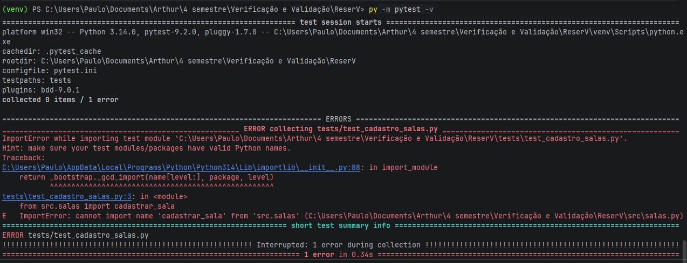 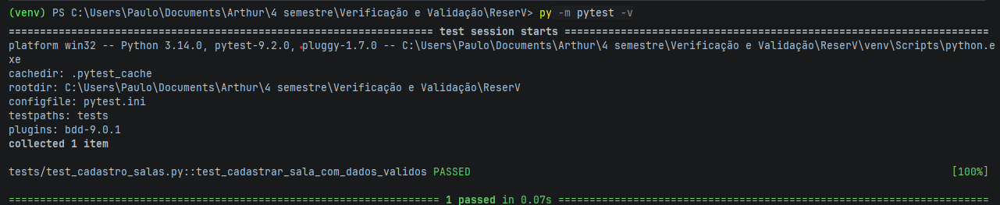

### Ciclo 2 — Validações do cadastro

- **Testes:**
  - `test_nao_cadastra_sala_com_nome_vazio` (casos: `""` e `"   "`);
  - `test_nao_cadastra_sala_com_localizacao_vazia` (casos: `""` e `"   "`);
  - `test_nao_cadastra_sala_com_capacidade_invalida` (casos: `0`, `-1`, `"abc"`, `2.5`).
  Cada um exige `ValueError` com a palavra-chave na mensagem e verifica que a lista continua vazia.
- **Red:** 1 passed, 8 failed, com `Failed: DID NOT RAISE <class 'ValueError'>`. A função aceitava dados inválidos.
- **Green:** validações de nome, localização e capacidade antes de gravar. Resultado: 9 passed.
- **Refactor:** extraída a função `_texto_preenchido`, que eliminou a repetição entre nome e localização. 9 passed.

Evidências: 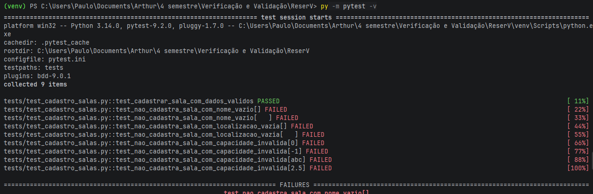 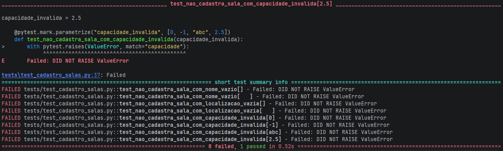 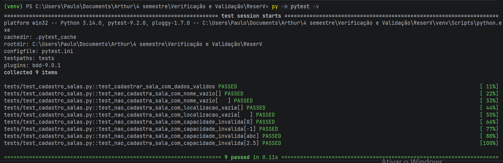 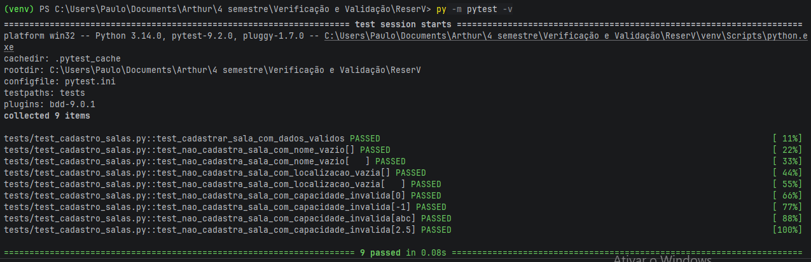

### Ciclo 3 — Várias salas e ids únicos

- **Testes:**
  - `test_cadastrar_varias_salas`: três salas guardadas em ordem, com ids `[1, 2, 3]`. Este teste já passava com o código existente e documenta o requisito.
  - `test_id_nao_e_reaproveitado_apos_remocao`: simula a exclusão de uma sala (funcionalidade do Integrante 2) e exige que o novo id não repita um id existente.
- **Red:** 10 passed, 1 failed (`assert 2 == 3`). O cálculo `len + 1` gerava um id duplicado após a remoção.
- **Green:** criados `gerar_id()` e o contador `_proximo_id` em `armazenamento.py`; `reiniciar()` passou a zerar o contador. Resultado: 11 passed.
- **Refactor:** extraída a função `_capacidade_valida`, deixando as três validações no mesmo padrão. 11 passed.

Evidências: 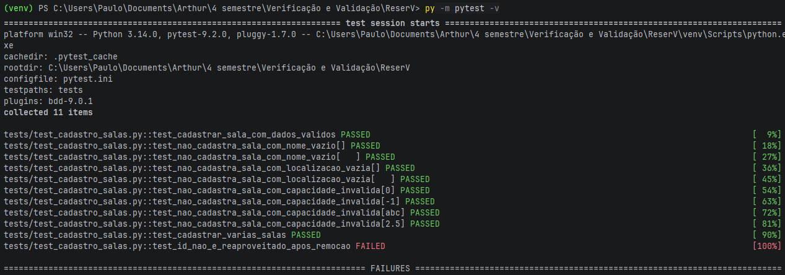 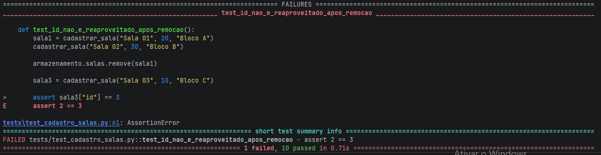 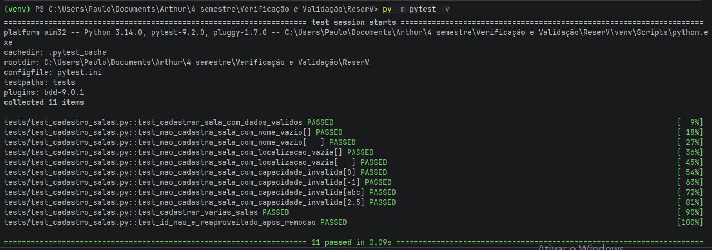 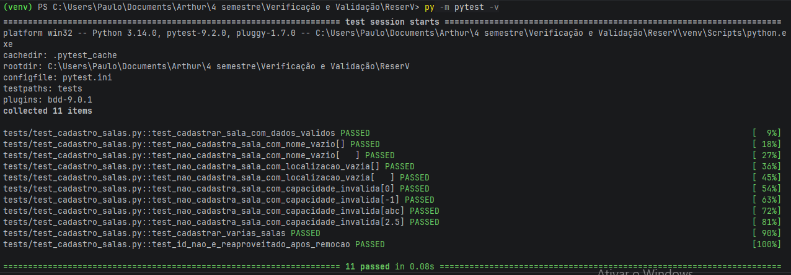

### Ciclo 4 — Listagem de salas

- **Testes:**
  - `test_listar_salas_cadastradas`: duas salas cadastradas aparecem na listagem, com todos os dados, na ordem de cadastro;
  - `test_listar_salas_sem_nenhuma_cadastrada`: sem salas, a listagem é uma lista vazia.
- **Red:** `ImportError: cannot import name 'listar_salas' from 'src.salas'`.
- **Green:** criada `listar_salas()`, que devolve uma cópia da lista guardada. Resultado: 13 passed.
- **Refactor:** nada a melhorar nesta etapa.

Evidências: 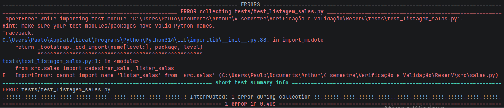 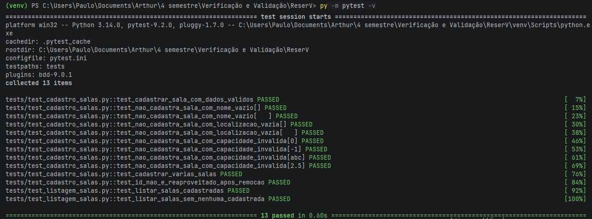

### Ciclo 5 — Formatação da listagem

- **Testes:**
  - `test_formatar_listagem_sem_salas_informa_que_nao_ha_salas`;
  - `test_formatar_listagem_mostra_todos_os_dados_das_salas` (cabeçalho, separador e uma linha por sala);
  - `test_formatar_listagem_alinha_as_colunas` (usa um nome longo ao lado de um curto).
- **Red:** `ImportError: cannot import name 'formatar_listagem' from 'src.salas'`.
- **Green:** criadas `formatar_listagem` e `_montar_linha`, com a largura de cada coluna ajustada ao maior texto. Resultado: 16 passed.
- **Refactor:** cálculo das larguras movido para `_calcular_larguras` e títulos reunidos na constante `TITULOS_LISTAGEM`. 16 passed.

Evidências: 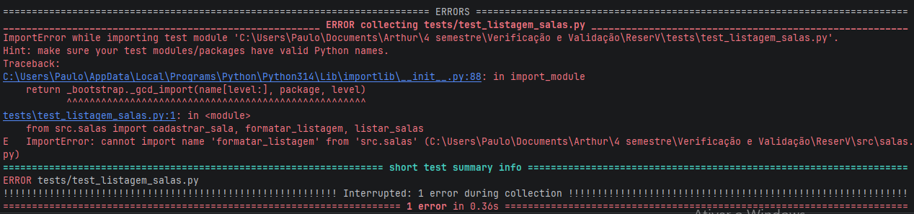 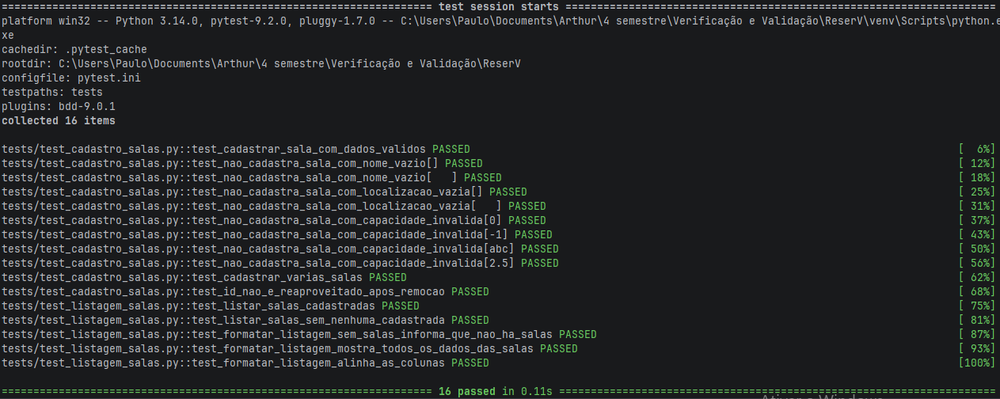 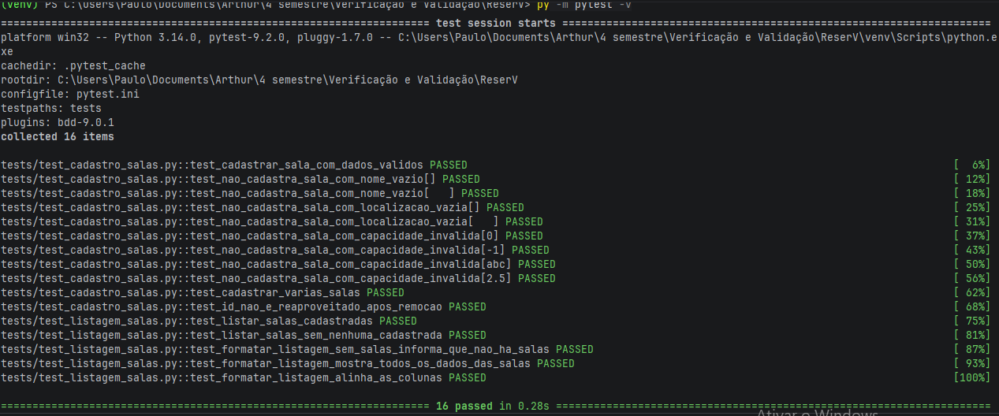

Exemplo de saída da listagem:

```
ID  Nome                        Capacidade  Localização
--  --------------------------  ----------  -----------
1   Sala 01                     20          Bloco A
2   Laboratório de Informática  35          Bloco B
```

---

## 6. BDD (Gherkin com pytest-bdd)

Arquivo `tests/features/cadastro_salas.feature`, escrito em português (`# language: pt`), com **9 cenários**:

| Tipo | Cenário |
|---|---|
| Positivo | Cadastrar uma sala com sucesso |
| Positivo | Cadastrar várias salas |
| Negativo | Não cadastrar sala com nome vazio |
| Negativo | Não cadastrar sala com localização vazia |
| Negativo | Não cadastrar sala com capacidade zero |
| Negativo | Não cadastrar sala com capacidade negativa |
| Negativo | Não cadastrar sala com capacidade que não é um número |
| Positivo | Listar salas cadastradas |
| Alternativo | Listar salas quando não há nenhuma cadastrada |

- **Red:** com apenas `scenarios("features/cadastro_salas.feature")` em `tests/test_bdd_salas.py`, os 9 cenários falharam com `StepDefinitionNotFoundError`: o comportamento estava documentado, mas ainda sem automação.
- **Green:** implementados os passos (`@given`, `@when`, `@then`) em `tests/test_bdd_salas.py`, ligando cada frase às funções `cadastrar_sala`, `listar_salas` e `formatar_listagem`. Resultado: 9 passed.
- **Refactor:** um único passo parametrizado atende todos os cenários de cadastro; nenhuma alteração adicional foi necessária.

Evidências: 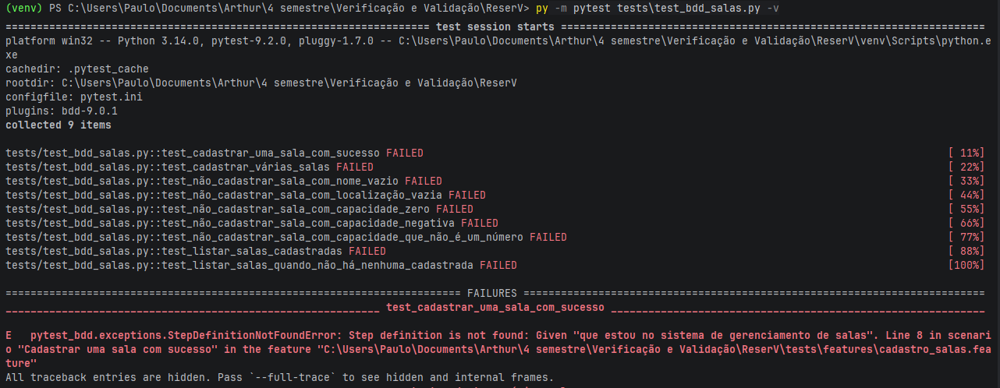 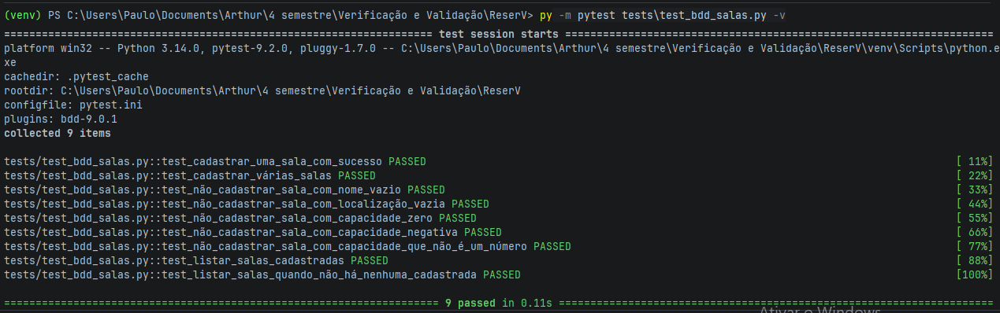

## 7. Interface de terminal

`src/interface.py` e `main.py` ligam as duas funcionalidades a um menu (1 - Cadastrar sala, 2 - Listar salas, 0 - Sair). A camada só usa `input` e `print`; as regras continuam em `salas.py`. Por ser uma camada de ligação, foi validada por execução manual do programa (`py main.py`), cobrindo: listagem vazia, cadastro válido, nome vazio, capacidade inválida, listagem alinhada, opção inválida e saída.

Evidência: 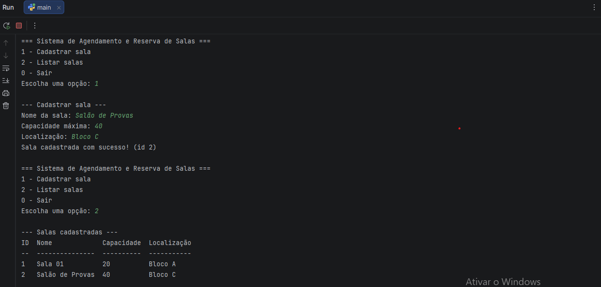

## 8. Resultado final

Suíte completa (`py -m pytest -v`): **25 testes passando** (16 de TDD e 9 de BDD).

Evidência: 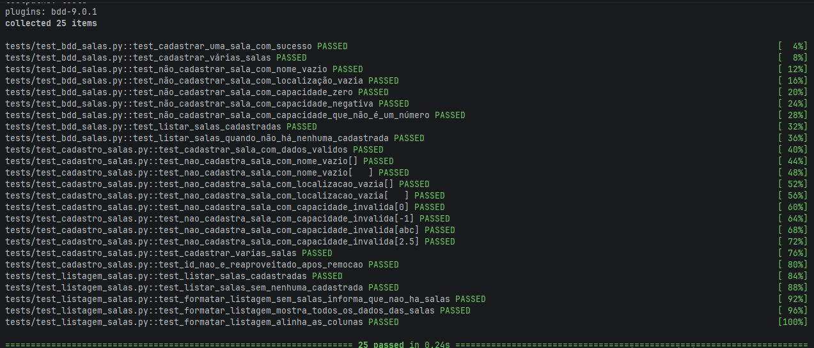

### Rastreabilidade dos requisitos

| Requisito | Teste TDD | Cenário BDD |
|---|---|---|
| Cadastrar sala com dados válidos | `test_cadastrar_sala_com_dados_validos` | Cadastrar uma sala com sucesso |
| Nome não pode estar vazio | `test_nao_cadastra_sala_com_nome_vazio` | Não cadastrar sala com nome vazio |
| Localização não pode estar vazia | `test_nao_cadastra_sala_com_localizacao_vazia` | Não cadastrar sala com localização vazia |
| Capacidade inteira maior que zero | `test_nao_cadastra_sala_com_capacidade_invalida` | Capacidade zero, negativa e não numérica |
| Identificador único | `test_cadastrar_varias_salas`, `test_id_nao_e_reaproveitado_apos_remocao` | Cadastrar várias salas |
| Sala adicionada à lista em memória | `test_cadastrar_sala_com_dados_validos` | Cadastrar uma sala com sucesso |
| Listar todas as salas | `test_listar_salas_cadastradas` | Listar salas cadastradas |
| Mensagem quando não há salas | `test_formatar_listagem_sem_salas_informa_que_nao_ha_salas` | Listar salas quando não há nenhuma cadastrada |
| Dados organizados no terminal | `test_formatar_listagem_mostra_todos_os_dados_das_salas`, `test_formatar_listagem_alinha_as_colunas` | Listar salas cadastradas |

## 9. Integração com os demais integrantes

- **Integrante 2 (editar e excluir):** altera ou remove itens de `armazenamento.salas`. Não precisa mexer no contador; o id de uma sala excluída não será reutilizado.
- **Integrante 3 (reservas):** pode vincular reservas ao `id` da sala, que é único e estável.
- **Integrante 4 (consultas):** pode usar `listar_salas()` e `formatar_listagem()` para exibir dados de salas.
- **Menu:** cada integrante adiciona sua opção em `exibir_menu()` e um novo `elif` em `executar()` (`src/interface.py`). Convém combinar no grupo quem edita esse arquivo e quando, para evitar conflitos no Git.

## 10. Como reproduzir

```powershell
python -m venv venv
venv\Scripts\Activate.ps1
pip install pytest pytest-bdd
py -m pytest -v          # todos os testes
py main.py               # executa o sistema
```
