# Registro de Desenvolvimento (TDD e BDD)

**Projeto:** Sistema de Agendamento e Reserva de Salas (Python, terminal)
**Integrante:** 3 — Reservas — Djames Henrique Renunza dos Santos
**Funcionalidades desenvolvidas:** (5) Realizar reserva e (6) Cancelar reserva
**Data:** 15/11/2026

---

## 1. Visão geral

A parte do Integrante 3 foi desenvolvida com **TDD** (Test Driven Development) e **BDD** (Behavior Driven Development), seguindo o mesmo fluxo dos demais integrantes:

1. **Red:** escrever o teste e executá-lo, comprovando que falha.
2. **Green:** escrever o mínimo de código para o teste passar.
3. **Refactor:** melhorar o código mantendo todos os testes passando.

| Ferramenta | Uso |
|---|---|
| Python | Linguagem do sistema (execução pelo terminal) |
| pytest | Testes automatizados (TDD) |
| pytest-bdd | Execução dos cenários Gherkin (BDD) |
| Git | Histórico da entrega e integração com o gerenciamento de salas |

Os dados continuam **somente em memória**: as reservas ficam na lista `armazenamento.reservas`, ao lado de `armazenamento.salas` (sem banco de dados, JSON ou arquivos).

---

## 2. Estrutura de arquivos

Arquivos criados ou alterados pelo Integrante 3:

```
ReserV/
├── requirements.txt                          # ALTERADO: pytest e pytest-bdd
├── src/
│   ├── armazenamento.py                      # ALTERADO: lista reservas e gerar_id_reserva()
│   ├── reservas.py                           # NOVO: realizar e cancelar reserva
│   ├── salas.py                              # ALTERADO (integração): exclusão aceita data dd/mm/aaaa e ignora reservas canceladas
│   └── interface.py                          # ALTERADO: opções de realizar e cancelar reserva
├── tests/
│   ├── test_reservas.py                      # NOVO: TDD da realização de reserva
│   ├── test_cancelamento_reservas.py         # NOVO: TDD do cancelamento
│   ├── test_integracao_reservas_exclusao.py  # NOVO: integração reservas × exclusão de salas
│   ├── test_bdd_reservas.py                  # NOVO: BDD (passos dos cenários)
│   └── features/
│       └── reservas.feature                  # NOVO: 6 cenários em Gherkin
└── docs/
    └── djames/
        ├── registro_tdd.md                   # este documento
        └── evidencias/
            ├── ciclo1/ … ciclo5/             # prints de cada fase dos ciclos TDD
            ├── bdd/                          # prints do BDD (Red e Green)
            └── suite/                        # print da suíte completa
```

---

## 3. Decisões de projeto

- **Formato da reserva:** `{"id": int, "sala_id": int, "responsavel": str, "data": str, "horario": str, "status": "ativa" | "cancelada"}`. É o formato usado depois pelas consultas (Integrante 4) e pela remarcação (Integrante 5).
- **Lista compartilhada:** `armazenamento.reservas`, zerada por `armazenamento.reiniciar()` junto com as salas. Assim a fixture do `conftest.py` continua isolando cada teste sem nenhuma alteração.
- **Identificador próprio:** `gerar_id_reserva()` usa um contador separado do das salas (`_proximo_id_reserva`). O id de reserva nunca é reaproveitado, mesmo após cancelamentos.
- **Vínculo pela sala:** a reserva guarda apenas o `sala_id`. Antes de gravar, `_sala_existe` confere se esse id está em `armazenamento.salas`.
- **Cancelar não apaga:** o cancelamento muda o `status` para `"cancelada"` e mantém a reserva na lista. Isso preserva o histórico e permite recusar um segundo cancelamento com mensagem clara.
- **Regra de conflito:** existe conflito quando há outra reserva **ativa** na **mesma sala, mesma data e mesmo horário** (`_existe_conflito`). Reserva cancelada libera o horário. A função foi reaproveitada pelo Integrante 4 na consulta de disponibilidade, para que consulta e reserva sigam a mesma regra.
- **Erros de validação:** `realizar_reserva` e `cancelar_reserva` levantam `ValueError` com mensagem clara; nada é gravado quando o dado é inválido. A ordem das validações é: sala → campos obrigatórios → conflito.
- **Funções sem interface:** `reservas.py` não usa `print` nem `input`. O menu (`interface.py`) apenas lê os dados, chama as funções e mostra a mensagem do erro.

---

## 4. Resumo dos ciclos TDD

| Ciclo | Foco | Testes | Red | Green | Refactor |
|---|---|---|---|---|---|
| 1 | Reserva com sala existente | 1 | `ImportError` (`realizar_reserva` inexistente) | 1 passed | Nenhum necessário |
| 2 | Sala inexistente | 1 | 1 failed, 1 passed (`DID NOT RAISE`) | 2 passed | Nenhum necessário |
| 3 | Campos obrigatórios | 3 casos | 3 failed, 2 passed (`DID NOT RAISE`) | 5 passed | Função `_texto_obrigatorio` |
| 4 | Conflito de horário | 1 | 1 failed, 5 passed (`DID NOT RAISE`) | 6 passed | Função `_existe_conflito` |
| 5 | Cancelamento de reserva | 3 | `ImportError` (`cancelar_reserva` inexistente) | 3 passed | Função `_buscar_reserva` |

Total de testes TDD do Integrante 3: **9** (6 em `test_reservas.py` e 3 em `test_cancelamento_reservas.py`).

---

## 5. Detalhamento dos ciclos

### Ciclo 0 — Preparação

`src/armazenamento.py` recebeu a lista `reservas`, o contador `_proximo_id_reserva` e a função `gerar_id_reserva()`. A função `reiniciar()` passou a limpar as reservas e zerar esse contador, para que a fixture automática do `conftest.py` deixe cada teste independente. Em `requirements.txt` foram registradas as dependências `pytest` e `pytest-bdd`. Foi criado o módulo vazio `src/reservas.py`, que os testes importam.

### Ciclo 1 — Realizar reserva com sala existente

- **Teste:** `test_realizar_reserva_com_sala_existente`. Cadastra `("Sala 01", 20, "Bloco A")`, reserva para `"Djames"` em `15/11/2026`, `19:00-20:00`, e verifica `sala_id`, responsável, data, horário, `status == "ativa"` e a presença da reserva em `armazenamento.reservas`.
- **Red:** `ImportError: cannot import name 'realizar_reserva' from 'src.reservas'`. A função ainda não existia (0 itens coletados, 1 erro).
- **Green:** criada `realizar_reserva(sala_id, responsavel, data, horario)`, que monta o dicionário com `gerar_id_reserva()`, status `"ativa"`, e o adiciona à lista. Resultado: 1 passed.
- **Refactor:** nada a melhorar nesta etapa.

Evidências:

Red — a coleta do teste falha porque `realizar_reserva` não existe em `src/reservas.py`:

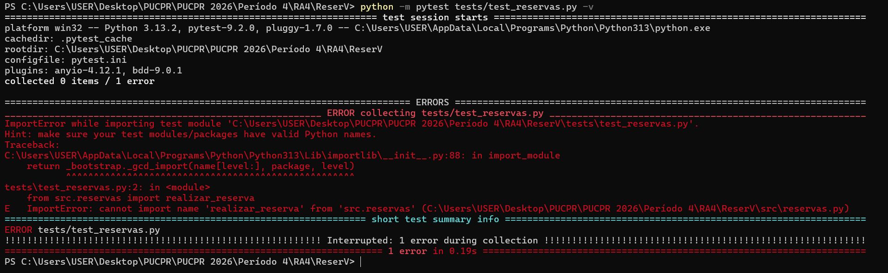

Green — `test_realizar_reserva_com_sala_existente` passa (1 passed):

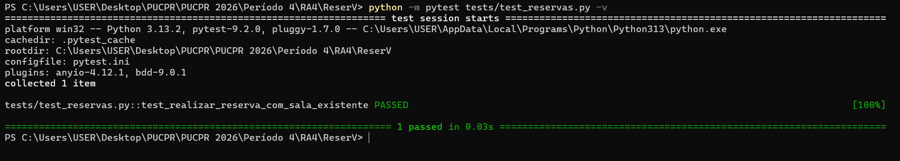

### Ciclo 2 — Recusar reserva de sala inexistente

- **Teste:** `test_nao_realizar_reserva_para_sala_inexistente`. Tenta reservar a sala `99`, que não foi cadastrada, e exige `ValueError` com `"Sala"` na mensagem.
- **Red:** 1 passed, 1 failed, com `Failed: DID NOT RAISE ValueError`. A função aceitava qualquer `sala_id`.
- **Green:** criada a função `_sala_existe`, que procura o id em `armazenamento.salas`; se não encontrar, `realizar_reserva` levanta `ValueError("Sala não encontrada.")`. Resultado: 2 passed.
- **Refactor:** nada a melhorar nesta etapa.

Evidências:

Red — o teste da sala 99 falha com `DID NOT RAISE ValueError`, enquanto o do ciclo 1 continua passando:

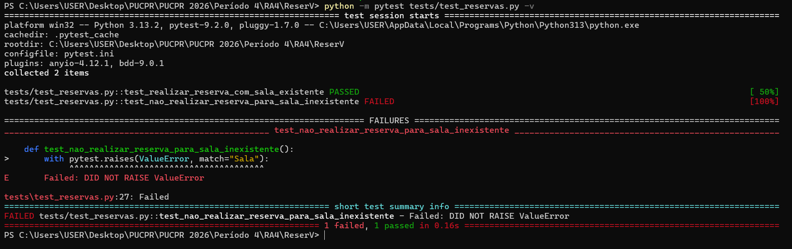

Green — os dois testes passam (2 passed):

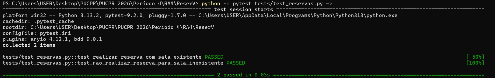

### Ciclo 3 — Campos obrigatórios

- **Teste:** `test_nao_realizar_reserva_com_campo_obrigatorio_vazio`, parametrizado com `responsavel`, `data` e `horario`. Em cada caso, um dos campos recebe `"   "` (só espaços); o teste exige `ValueError` com `"obrigat"` na mensagem e confere que `armazenamento.reservas` continua vazia.
- **Red:** 2 passed, 3 failed (`[responsavel]`, `[data]` e `[horario]`), todos com `Failed: DID NOT RAISE ValueError`. A reserva era gravada mesmo com campos em branco.
- **Green:** antes de gravar, `realizar_reserva` passou a conferir se cada campo é texto e não está vazio após `strip()`, levantando `ValueError("O campo <nome> é obrigatório.")`. Resultado: 5 passed.
- **Refactor:** as três verificações repetidas foram reunidas na função `_texto_obrigatorio(valor, campo)`, que recebe o nome do campo para montar a mensagem (`"responsável"`, `"data"`, `"horário"`). 5 passed. Essa função foi reaproveitada depois pelo Integrante 4 na consulta de disponibilidade.

Evidências:

Red — os três casos parametrizados falham com `DID NOT RAISE ValueError` (3 failed, 2 passed):

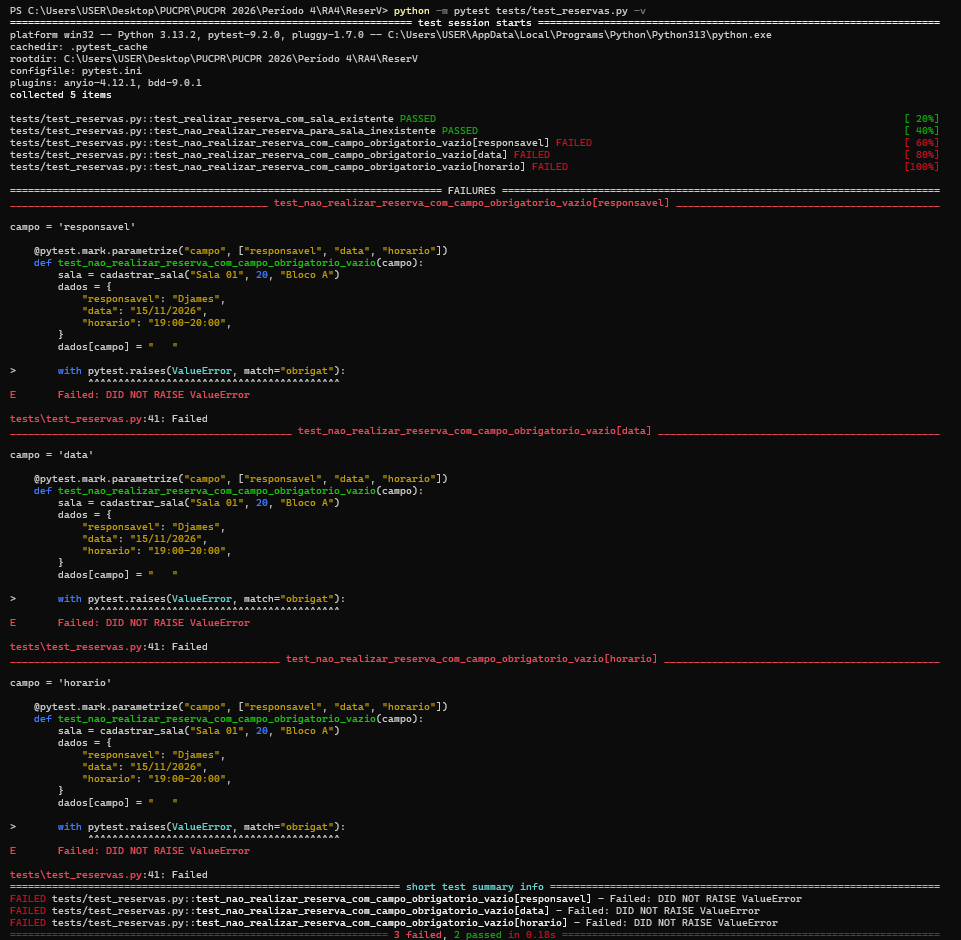

Green — os cinco testes passam após as validações:

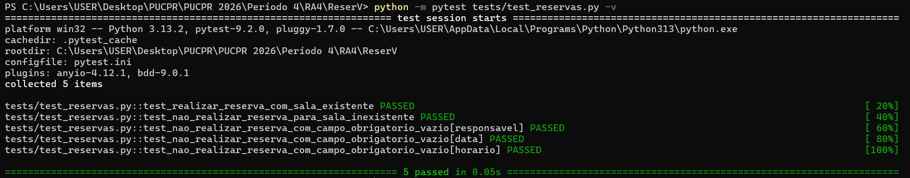

Refactor — mesma execução depois de extrair `_texto_obrigatorio`, ainda com 5 passed:

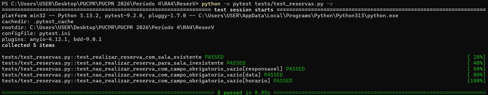

### Ciclo 4 — Impedir conflito de horário

- **Teste:** `test_nao_permitir_reservas_conflitantes`. Reserva a sala para `"Djames"` em `15/11/2026`, `19:00-20:00`, e tenta reservar a mesma sala, data e horário para `"Outra pessoa"`; exige `ValueError` com `"reservado"` na mensagem.
- **Red:** 5 passed, 1 failed, com `Failed: DID NOT RAISE ValueError`. A segunda reserva era aceita, ocupando o mesmo horário duas vezes.
- **Green:** antes de gravar, `realizar_reserva` passou a percorrer as reservas e recusar quando já existe uma reserva ativa com o mesmo `sala_id`, `data` e `horario`, levantando `ValueError("O horário já está reservado para esta sala.")`. Resultado: 6 passed.
- **Refactor:** a verificação foi movida para a função `_existe_conflito(sala_id, data, horario)`, escrita com `any(...)`. Ela considera apenas reservas com `status == "ativa"`, deixando pronto o comportamento do cancelamento (reserva cancelada libera o horário). 6 passed.

Evidências:

Red — `test_nao_permitir_reservas_conflitantes` falha com `DID NOT RAISE ValueError` (1 failed, 5 passed):

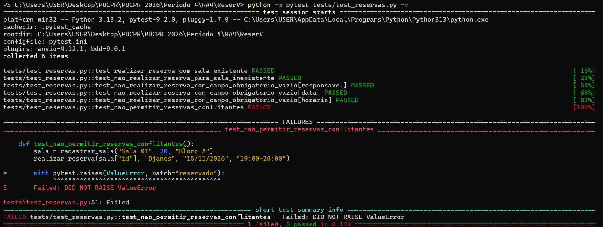

Green — os seis testes de `test_reservas.py` passam:

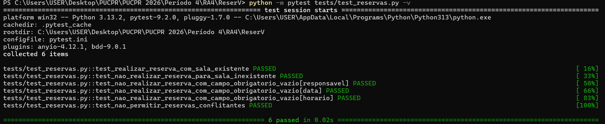

Refactor — mesma execução depois de extrair `_existe_conflito`, ainda com 6 passed:

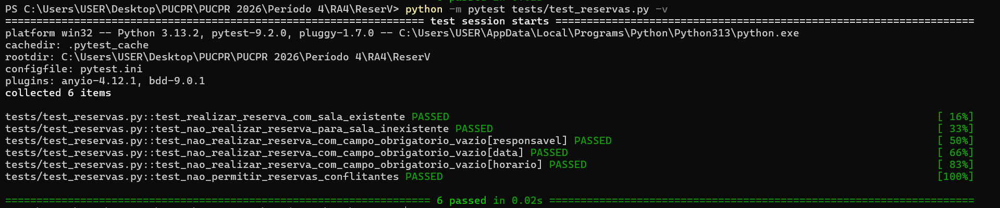

### Ciclo 5 — Cancelar reserva

- **Testes** (em `test_cancelamento_reservas.py`, com a função auxiliar `criar_reserva()` para montar sala e reserva):
  - `test_cancelar_reserva_existente`: cancela a reserva criada e verifica `status == "cancelada"`;
  - `test_nao_cancelar_reserva_inexistente`: cancelar o id `99` exige `ValueError` com `"Reserva"` na mensagem;
  - `test_nao_cancelar_reserva_ja_cancelada`: cancelar duas vezes a mesma reserva exige `ValueError` com `"cancelada"` na mensagem.
- **Red:** `ImportError: cannot import name 'cancelar_reserva' from 'src.reservas'`. A função ainda não existia (0 itens coletados, 1 erro).
- **Green:** criada `cancelar_reserva(reserva_id)`, que procura a reserva pelo id, levanta `ValueError("Reserva não encontrada.")` quando não existe, `ValueError("A reserva já está cancelada.")` quando o status já é `"cancelada"`, e caso contrário troca o status para `"cancelada"` e devolve a reserva. Resultado: 3 passed.
- **Refactor:** a busca pelo id foi separada na função `_buscar_reserva(reserva_id)`, que usa `next(...)` e devolve `None` quando não encontra. `cancelar_reserva` ficou só com as regras do cancelamento. 3 passed.

Evidências:

Red — a coleta falha porque `cancelar_reserva` não existe em `src/reservas.py`:

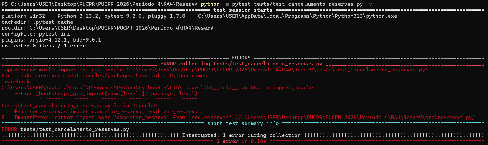

Green — os três testes de cancelamento passam:

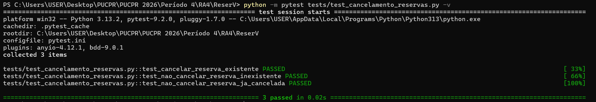

Refactor — mesma execução depois de extrair `_buscar_reserva`, ainda com 3 passed:

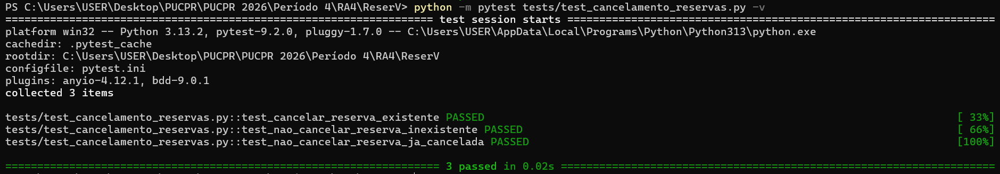

---

## 6. BDD (Gherkin com pytest-bdd)

Arquivo `tests/features/reservas.feature`, escrito em português (`# language: pt`), com **6 cenários**:

| Tipo | Cenário |
|---|---|
| Positivo | Realizar uma reserva com sucesso |
| Negativo | Recusar reserva de sala inexistente |
| Negativo | Impedir conflito de horário |
| Positivo | Cancelar uma reserva existente |
| Negativo | Recusar cancelamento de reserva inexistente |
| Negativo | Recusar cancelamento repetido |

- **Red:** foi criado o arquivo temporário `tests/test_bdd_reservas_red.py`, contendo apenas `scenarios("features/reservas.feature")`. Os 6 cenários falharam com `StepDefinitionNotFoundError` já no primeiro passo `Dado` de cada um: o comportamento estava descrito, mas ainda sem automação. Depois da captura, o arquivo temporário foi removido.
- **Green:** implementados os passos (`@given`, `@when`, `@then`) em `tests/test_bdd_reservas.py`, ligando cada frase às funções `cadastrar_sala`, `realizar_reserva` e `cancelar_reserva`. Os passos de tentativa (`tento reservar…`, `tento cancelar…`) capturam o `ValueError` e guardam a mensagem, para que o `Então` compare o texto exato exibido ao usuário. Resultado: 6 passed.
- **Refactor:** os passos usam `parsers.parse` para receber responsável, data, horário e ids direto do texto do cenário, e `target_fixture` para passar sala, reserva e resultado entre as etapas. Nenhuma alteração adicional foi necessária.

Evidências:

Red — os 6 cenários falham com `StepDefinitionNotFoundError` (6 failed):

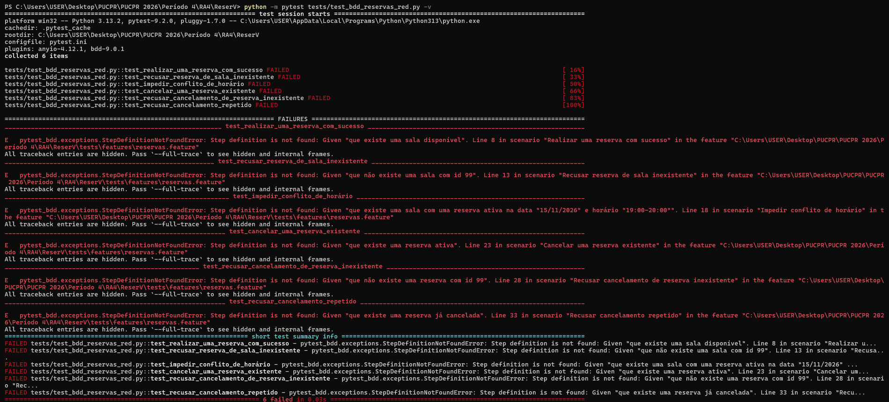

Green — os 6 cenários passam com os passos implementados em `tests/test_bdd_reservas.py`:

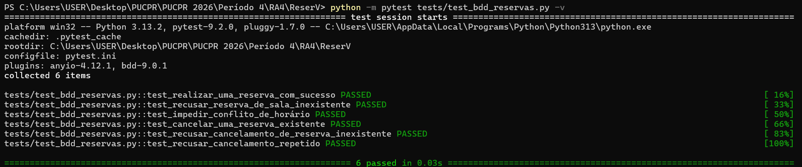

---

## 7. Interface de terminal

`src/interface.py` ganhou as funções `opcao_realizar_reserva` e `opcao_cancelar_reserva`. A camada só usa `input` e `print`: lê os dados, converte os ids com `_converter_inteiro` e mostra a mensagem do `ValueError` quando a operação é recusada. As regras continuam em `reservas.py`.

Na primeira versão as opções eram 3 e 4. Depois da integração com o Integrante 2 (editar e excluir salas), o menu passou a usar **5 - Realizar reserva** e **6 - Cancelar reserva**.

Por ser uma camada de ligação, foi validada por execução manual (`python main.py`), cobrindo reserva válida, conflito, sala inexistente, campo vazio, cancelamento, cancelamento repetido e reserva inexistente:

```
--- Realizar reserva ---
ID da sala: 1 | Responsável: Djames | Data: 15/11/2026 | Horário: 19:00-20:00
Reserva realizada com sucesso! (id 1)

--- Realizar reserva ---   (mesma sala, data e horário)
Não foi possível realizar a reserva: O horário já está reservado para esta sala.

--- Realizar reserva ---   (sala 99)
Não foi possível realizar a reserva: Sala não encontrada.

--- Realizar reserva ---   (responsável em branco)
Não foi possível realizar a reserva: O campo responsável é obrigatório.

--- Cancelar reserva ---   (id 1)
Reserva cancelada com sucesso!

--- Cancelar reserva ---   (id 1 de novo)
Não foi possível cancelar: A reserva já está cancelada.

--- Cancelar reserva ---   (id 99)
Não foi possível cancelar: Reserva não encontrada.
```

---

## 8. Resultado final

Suíte completa no momento da entrega (`python -m pytest -v`): **40 testes passando**, sendo os 25 do Integrante 1 e os 15 do Integrante 3 (9 de TDD e 6 de BDD).

Evidência — os 40 testes da suíte passando, incluindo `test_reservas.py`, `test_cancelamento_reservas.py` e `test_bdd_reservas.py`:

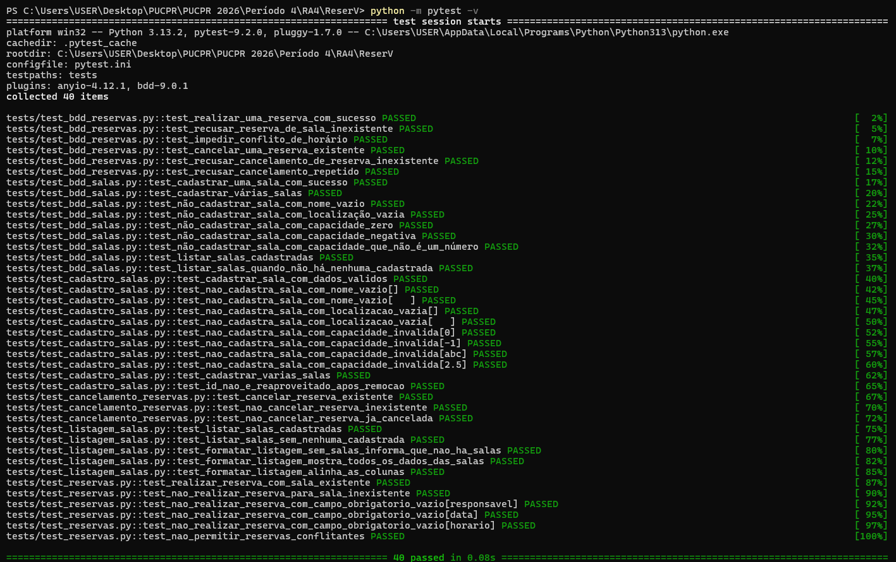

Com a integração das salas e os testes de `test_integracao_reservas_exclusao.py`, a parte do Integrante 3 soma **17 testes** (9 TDD, 6 BDD e 2 de integração).

### Rastreabilidade dos requisitos

| Requisito | Teste TDD | Cenário BDD |
|---|---|---|
| Realizar reserva para sala existente | `test_realizar_reserva_com_sala_existente` | Realizar uma reserva com sucesso |
| Reserva criada com status ativa | `test_realizar_reserva_com_sala_existente` | Realizar uma reserva com sucesso |
| Recusar sala inexistente | `test_nao_realizar_reserva_para_sala_inexistente` | Recusar reserva de sala inexistente |
| Responsável, data e horário obrigatórios | `test_nao_realizar_reserva_com_campo_obrigatorio_vazio` | — |
| Impedir conflito de horário | `test_nao_permitir_reservas_conflitantes` | Impedir conflito de horário |
| Cancelar reserva existente | `test_cancelar_reserva_existente` | Cancelar uma reserva existente |
| Recusar cancelamento de reserva inexistente | `test_nao_cancelar_reserva_inexistente` | Recusar cancelamento de reserva inexistente |
| Recusar cancelamento repetido | `test_nao_cancelar_reserva_ja_cancelada` | Recusar cancelamento repetido |
| Reserva futura bloqueia exclusão da sala | `test_reserva_futura_no_formato_br_impede_excluir_sala` | — |
| Reserva cancelada não bloqueia exclusão | `test_reserva_cancelada_nao_impede_excluir_sala` | — |

---

## 9. Integração com os demais integrantes

- **Integrante 1 (cadastro):** as reservas usam o `id` da sala, que é único e não é reaproveitado.
- **Integrante 2 (editar e excluir):** a exclusão de sala é bloqueada quando há reservas futuras. No merge (`merge: integra reservas e gerenciamento de salas`), `_converter_data` em `salas.py` passou a aceitar a data no formato `dd/mm/aaaa`, que é o formato usado nas reservas, e `_tem_reservas_futuras` passou a ignorar reservas canceladas. Os dois comportamentos ficaram cobertos por `tests/test_integracao_reservas_exclusao.py`.
- **Integrante 4 (consultas):** reaproveita `_existe_conflito` e `_texto_obrigatorio` de `reservas.py`, de modo que consultar a disponibilidade e reservar seguem a mesma regra e as mesmas mensagens.
- **Integrante 5 (remarcação):** altera data e horário de reservas existentes em `armazenamento.reservas`, usando a mesma regra de conflito e recusando reservas canceladas.

---

## 10. Como reproduzir

```powershell
python -m venv venv
venv\Scripts\Activate.ps1
pip install -r requirements.txt
python -m pytest tests/test_reservas.py -v
python -m pytest tests/test_cancelamento_reservas.py -v
python -m pytest tests/test_bdd_reservas.py -v
python -m pytest tests/test_integracao_reservas_exclusao.py -v
python -m pytest -v          # todos os testes
python main.py               # executa o sistema
```
