# Registro de Desenvolvimento (TDD e BDD)

**Projeto:** Sistema de Agendamento e Reserva de Salas (Python, terminal)
**Integrante:** 5 — Busca e remarcação — Gustavo
**Funcionalidades desenvolvidas:** (1) Buscar salas por capacidade mínima e localização e (2) Remarcar reserva
**Data:** 15/11/2026

---

## 1. Visão geral

A parte do Integrante 5 foi desenvolvida com **TDD** (Test Driven Development) e **BDD** (Behavior Driven Development), sempre na ordem:

1. **Red:** escrever o teste e executá-lo, comprovando que falha.
2. **Green:** escrever o mínimo de código para o teste passar.
3. **Refactor:** melhorar o código mantendo todos os testes passando.

| Ferramenta | Uso |
|---|---|
| Python | Linguagem do sistema (execução pelo terminal) |
| pytest | Testes automatizados (TDD) |
| pytest-bdd | Execução dos cenários Gherkin (BDD) |
| Git | Histórico: cada fase (Red, Green, Refactor) foi registrada em commit na branch `feature/buscar-e-remarcar` |

Os dados ficam **somente em memória**, nas estruturas compartilhadas do projeto (sem banco de dados, JSON ou arquivos).

## 2. Estrutura de arquivos (parte do Integrante 5)

```
ReserV/
├── src/
│   ├── buscas.py                        # busca de salas e formatação do resultado
│   └── remarcacao.py                    # regras da remarcação de reservas
├── tests/
│   ├── test_busca_salas.py              # TDD: busca
│   ├── test_remarcacao_reservas.py      # TDD: remarcação
│   ├── test_bdd_busca_remarcacao.py     # BDD: passos dos cenários
│   └── features/
│       ├── busca_salas.feature          # 6 cenários em Gherkin
│       └── remarcacao_reservas.feature  # 7 cenários em Gherkin
└── docs/
    └── gustavo/
        ├── registro_tdd.md              # este documento
        └── evidencias/                  # prints dos ciclos
```

## 3. Decisões de projeto

**Busca de salas**

- A busca aceita **capacidade mínima**, **localização** ou os **dois critérios combinados**.
- Uma sala com capacidade **igual** ao mínimo informado entra no resultado.
- A localização **ignora maiúsculas e minúsculas** e **aceita parte do texto**.
- Sem nenhum critério, a busca é recusada com `ValueError`. Capacidade mínima e localização inválidas também são recusadas.
- Quando nenhuma sala atende aos critérios, o resultado é uma **lista vazia** e a formatação mostra a mensagem "Nenhuma sala encontrada para os critérios informados."
- A formatação do resultado é separada da busca (`formatar_resultado_busca`), mantendo a lógica fora do terminal.

**Remarcação de reservas**

- A remarcação **mantém** o id, a sala, o responsável e o status da reserva; só mudam a data e o horário.
- O horário antigo da sala é **liberado** e o novo passa a ser ocupado.
- É recusada a remarcação de reserva **inexistente**, **cancelada**, com **campo vazio**, para a **mesma data e horário** e de reserva cuja **sala foi excluída**.
- Um horário ocupado por **outra reserva ativa da mesma sala** é recusado. Já um horário ocupado em **outra sala**, ou por uma reserva **cancelada**, é permitido.
- Os erros de validação são levantados como `ValueError` com mensagem clara, e a reserva não é alterada quando a remarcação falha.

## 4. Resumo dos ciclos TDD

| Ciclo | Foco | Testes | Red | Green | Refactor |
|---|---|---|---|---|---|
| 1 | Busca por capacidade mínima | 4 | `ModuleNotFoundError` (módulo `src.buscas`) | 4 passed (104 na suíte) | Nenhum necessário |
| 2 | Busca por localização e combinação | 4 | 4 failed, 104 passed | 108 passed | Nenhum necessário |
| 3 | Validações da busca | 9 execuções | 9 failed, 108 passed | 117 passed | Estrutura do código melhorada (117 passed) |
| 4 | Formatação do resultado da busca | 2 | `ImportError` (função inexistente) | 119 passed | Nenhum necessário |
| 5 | Remarcação com horário livre | 3 | `ModuleNotFoundError` (módulo `src.remarcacao`) | 122 passed | Nenhum necessário |
| 6 | Validações e recusas da remarcação | 8 execuções | 8 failed, 122 passed | 130 passed | Nenhum necessário |
| 7 | Conflito de horário | 3 | 1 failed, 132 passed | 133 passed | Estrutura do código melhorada (133 passed) |

Total de testes TDD do Integrante 5: **33 execuções** (22 funções de teste, com 3 delas parametrizadas).

| Fase | Commits |
|---|---|
| Ciclo 1 | Red `4a67103`, Green `544a3d0` |
| Ciclo 2 | Red `45d5ecc`, Green `60a3b73` |
| Ciclo 3 | Red `a4571bf`, Green `77547c2`, Refactor `bc2e42c` |
| Ciclo 4 | Red `3b7751d`, Green `f23cd88` |
| Ciclo 5 | Red `d76d8cb`, Green `1cbab0c` |
| Ciclo 6 | Red `95711db`, Green `794faf4` |
| Ciclo 7 | Red `8a00ce6`, Green `0447175`, Refactor `b45c55d` |
| BDD | Red `260b56e`, Green `d9027a7` |

---

## 5. Detalhamento dos ciclos

### Ciclo 1 — Busca por capacidade mínima

- **Testes** (`tests/test_busca_salas.py`):
  - `test_buscar_salas_por_capacidade_minima`;
  - `test_buscar_salas_inclui_sala_com_capacidade_igual_ao_minimo`;
  - `test_buscar_salas_sem_resultado_devolve_lista_vazia`;
  - `test_buscar_salas_sem_salas_cadastradas_devolve_lista_vazia`.
- **Red:** `ModuleNotFoundError: No module named 'src.buscas'`. O módulo de busca ainda não existia, então o pytest coletou 0 itens e 1 erro. Commit `4a67103`.
- **Green:** criado `src/buscas.py` com a função `buscar_salas`, com o mínimo necessário. Resultado: 4 passed no arquivo de busca (104 passed na suíte completa). Commit `544a3d0`.
- **Refactor:** nada a melhorar nesta etapa.

Evidências: 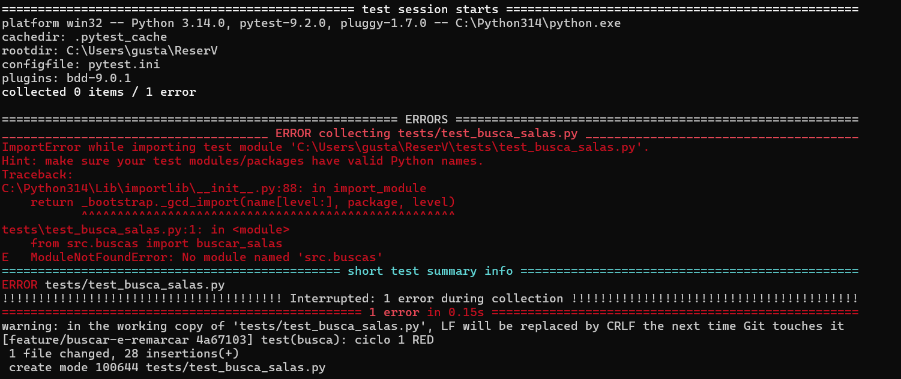 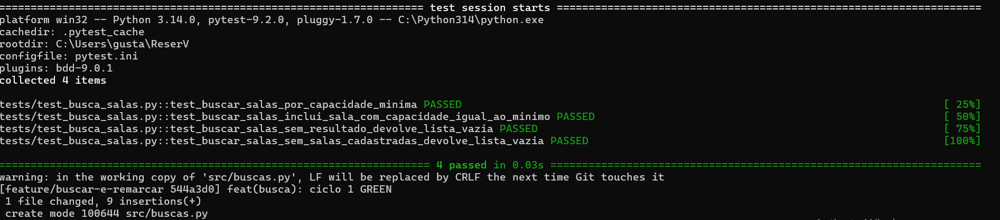

### Ciclo 2 — Busca por localização e combinação de critérios

- **Testes:**
  - `test_buscar_salas_por_localizacao`;
  - `test_buscar_salas_por_localizacao_ignora_maiusculas_e_minusculas`;
  - `test_buscar_salas_por_localizacao_aceita_parte_do_texto`;
  - `test_buscar_salas_combinando_capacidade_e_localizacao`.
- **Red:** 4 failed, 104 passed, com `TypeError`: a função ainda não aceitava o critério de localização. Commit `45d5ecc`.
- **Green:** `buscar_salas` passou a filtrar também por localização (sem diferenciar maiúsculas, aceitando parte do texto) e a combinar os dois critérios. Resultado: 108 passed. Commit `60a3b73`.
- **Refactor:** nada a melhorar nesta etapa.

Evidências: 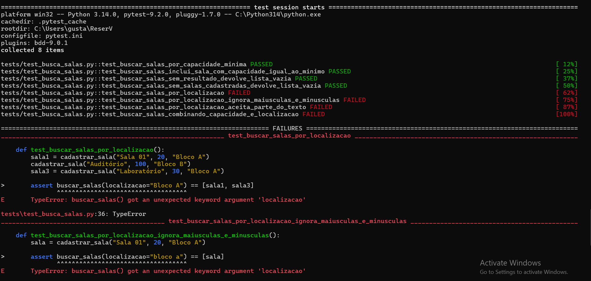 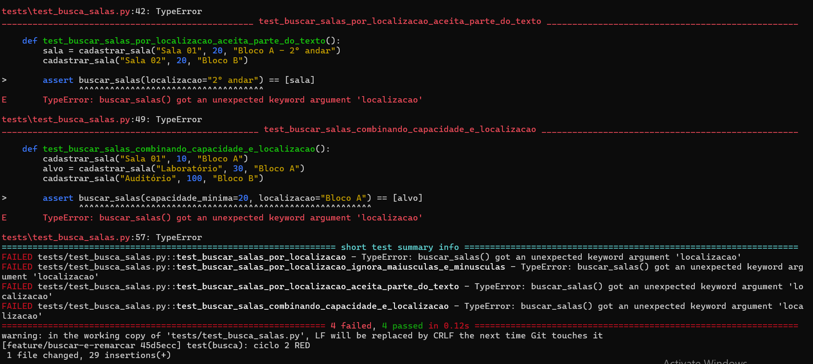 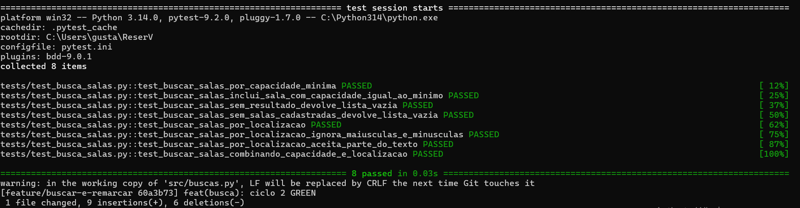

### Ciclo 3 — Validações da busca

- **Testes:**
  - `test_nao_buscar_sem_nenhum_criterio`;
  - `test_nao_buscar_com_capacidade_minima_invalida` (parametrizado, incluindo `True`);
  - `test_nao_buscar_com_localizacao_invalida` (parametrizado, incluindo `""`, `"   "` e `10`).
  Cada um exige `ValueError` na busca com dados inválidos.
- **Red:** 9 failed, 108 passed. A busca aceitava critérios ausentes ou inválidos. Commit `a4571bf`.
- **Green:** validações dos critérios antes de filtrar as salas. Resultado: 117 passed. Commit `77547c2`.
- **Refactor:** estrutura do código melhorada sem mudar o comportamento. 117 passed. Commit `bc2e42c`.

Evidências: 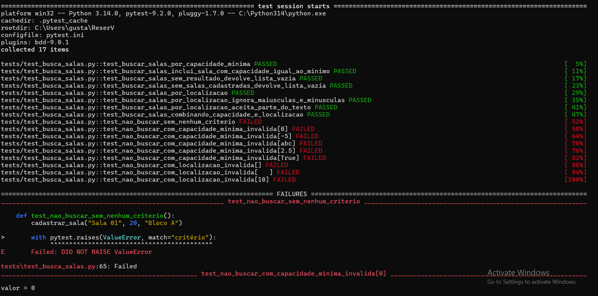 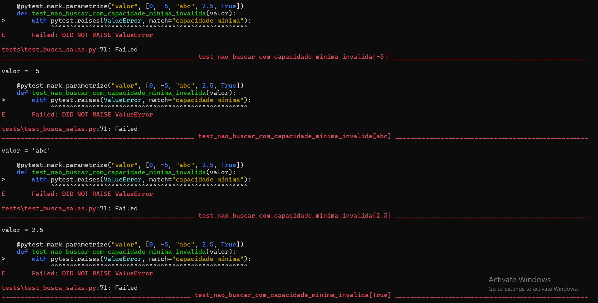 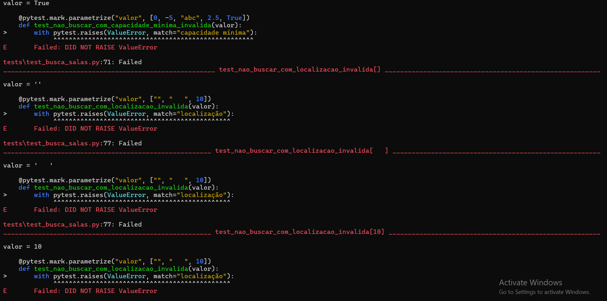 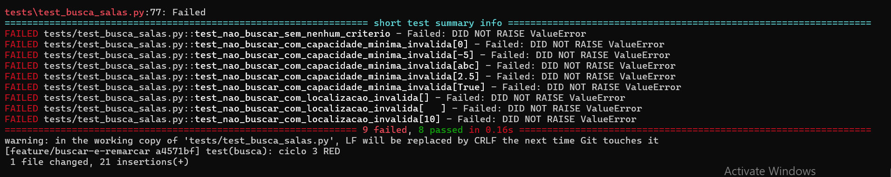 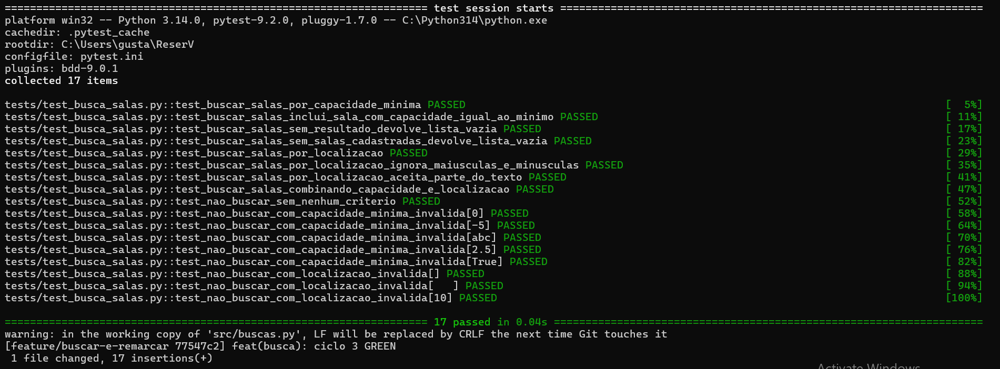 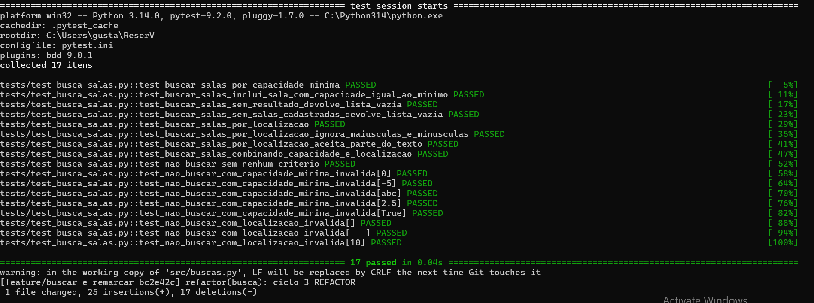

### Ciclo 4 — Formatação do resultado da busca

- **Testes:**
  - `test_formatar_resultado_vazio_informa_que_nenhuma_sala_foi_encontrada`;
  - `test_formatar_resultado_mostra_tabela_das_salas`.
- **Red:** `ImportError: cannot import name 'formatar_resultado_busca' from 'src.buscas'`. Commit `3b7751d`.
- **Green:** criada `formatar_resultado_busca`, que devolve a tabela das salas encontradas ou a mensagem de que nenhuma sala foi encontrada. Resultado: 119 passed. Commit `f23cd88`.
- **Refactor:** nada a melhorar nesta etapa.

Evidências: 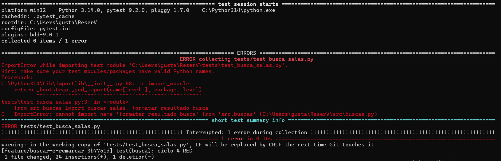 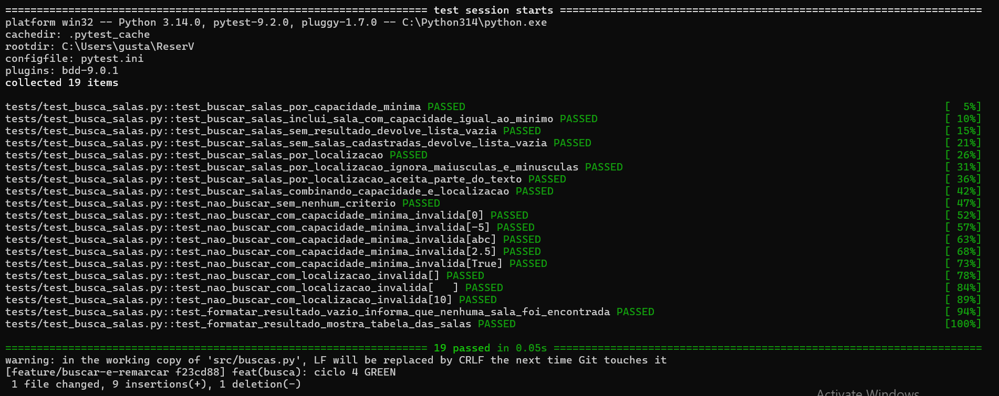

### Ciclo 5 — Remarcação com horário livre

- **Testes** (`tests/test_remarcacao_reservas.py`):
  - `test_remarcar_reserva_para_horario_livre`;
  - `test_remarcar_reserva_mantem_id_sala_responsavel_e_status`;
  - `test_remarcar_reserva_libera_o_horario_antigo_e_ocupa_o_novo`.
- **Red:** `ModuleNotFoundError: No module named 'src.remarcacao'`. Commit `d76d8cb`.
- **Green:** criado `src/remarcacao.py`, que altera a data e o horário da reserva e mantém os demais dados. Resultado: 122 passed. Commit `1cbab0c`.
- **Refactor:** nada a melhorar nesta etapa.

Evidências: 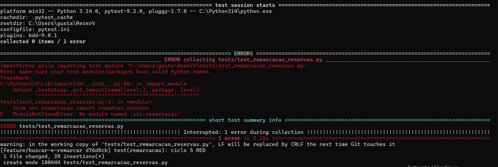 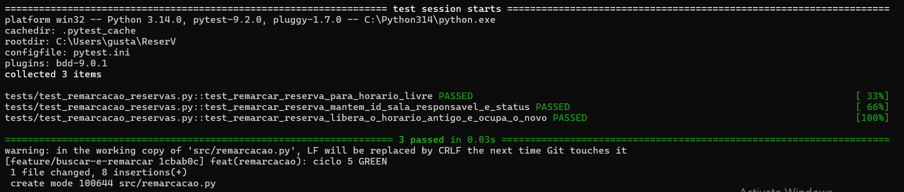

### Ciclo 6 — Validações e recusas da remarcação

- **Testes:**
  - `test_nao_remarcar_reserva_inexistente`;
  - `test_nao_remarcar_reserva_cancelada`;
  - `test_nao_remarcar_com_campo_obrigatorio_vazio` (parametrizado, com data ou horário vazios);
  - `test_nao_remarcar_para_a_mesma_data_e_horario`;
  - `test_nao_remarcar_reserva_de_sala_que_foi_excluida`.
- **Red:** 8 failed, 122 passed. A remarcação aceitava casos que devem ser recusados. Commit `95711db`.
- **Green:** validações antes de alterar a reserva, com `ValueError` e mensagem clara. Resultado: 130 passed. Commit `794faf4`.
- **Refactor:** nada a melhorar nesta etapa.

Evidências: 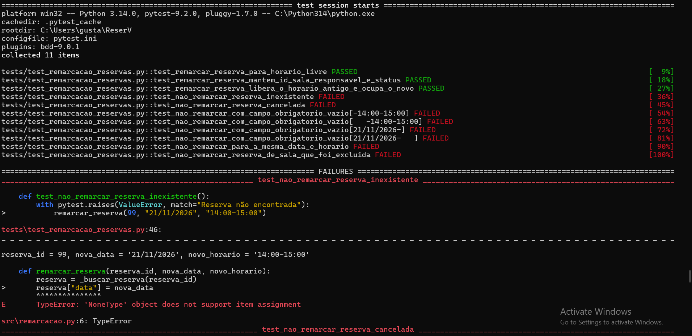 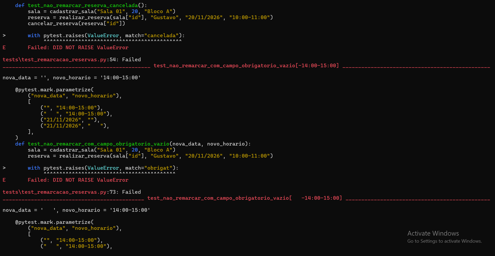 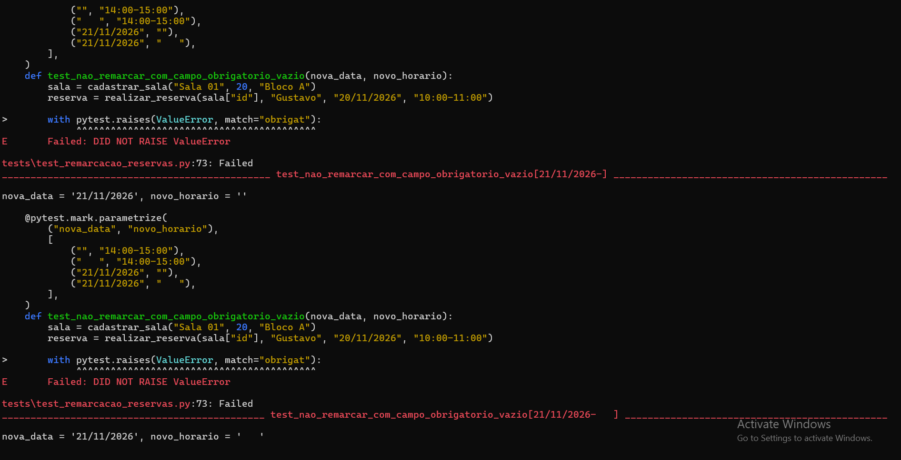 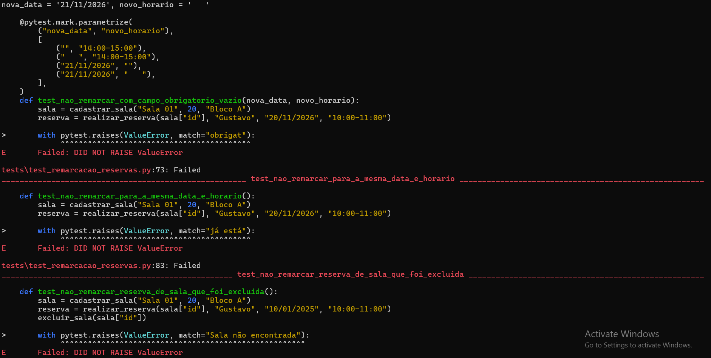 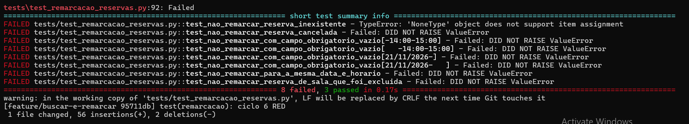 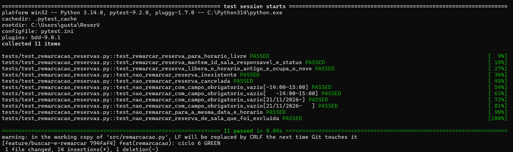

### Ciclo 7 — Conflito de horário

- **Testes:**
  - `test_nao_remarcar_para_horario_ocupado_por_outra_reserva`;
  - `test_remarcar_para_horario_ocupado_em_outra_sala_e_permitido`;
  - `test_remarcar_para_horario_de_reserva_cancelada_e_permitido`.
  Os dois últimos já passavam com o código existente e documentam o requisito.
- **Red:** 1 failed, 132 passed, com `Failed: DID NOT RAISE ValueError`. A remarcação permitia um horário já ocupado na mesma sala. Commit `8a00ce6`.
- **Green:** verificação de conflito apenas entre reservas ativas da mesma sala. Resultado: 133 passed. Commit `0447175`.
- **Refactor:** estrutura do código melhorada sem mudar o comportamento. 133 passed. Commit `b45c55d`.

Evidências: 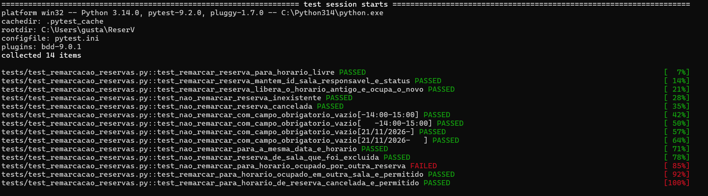 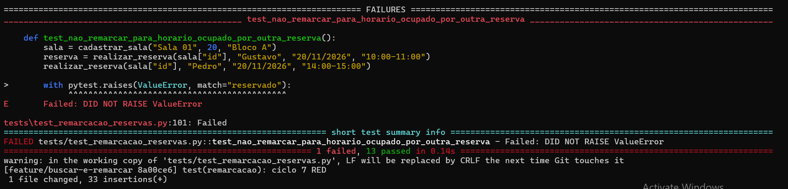 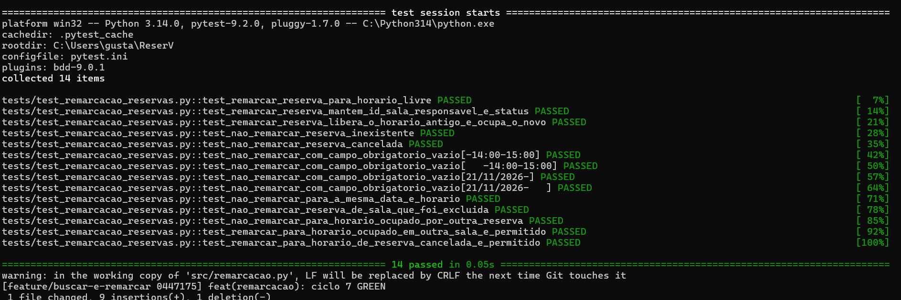 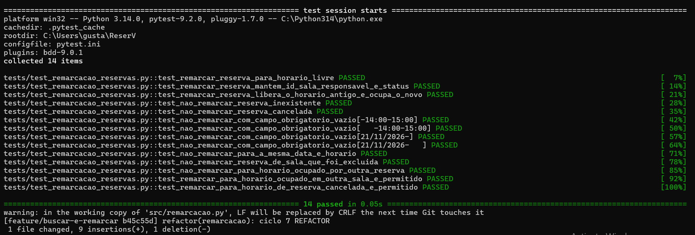

---

## 6. BDD (Gherkin com pytest-bdd)

Dois arquivos escritos em português (`# language: pt`), com **13 cenários**:

**`tests/features/busca_salas.feature` (6 cenários)**

| Tipo | Cenário |
|---|---|
| Positivo | Buscar salas por capacidade mínima |
| Positivo | Buscar salas por localização |
| Positivo | Combinar capacidade mínima e localização |
| Alternativo | Busca sem nenhuma sala que atenda aos critérios |
| Negativo | Recusar busca sem critérios |
| Negativo | Recusar capacidade mínima inválida |

**`tests/features/remarcacao_reservas.feature` (7 cenários)**

| Tipo | Cenário |
|---|---|
| Positivo | Remarcar reserva para um horário livre |
| Positivo | Remarcar libera o horário antigo da sala |
| Negativo | Recusar remarcação para horário ocupado |
| Negativo | Recusar remarcação de reserva inexistente |
| Negativo | Recusar remarcação de reserva cancelada |
| Negativo | Recusar remarcação sem data |
| Negativo | Recusar remarcação para a mesma data e horário |

- **Red:** com os cenários carregados e os passos ainda sem implementação, os 13 cenários falharam (13 failed, 133 passed). O comportamento estava documentado, mas sem automação. Commit `260b56e`.
- **Green:** implementados os passos em `tests/test_bdd_busca_remarcacao.py`, ligando cada frase às funções de busca e remarcação. Resultado: 146 passed. Commit `d9027a7`.
- **Refactor:** nenhuma alteração adicional foi necessária.

Evidências: 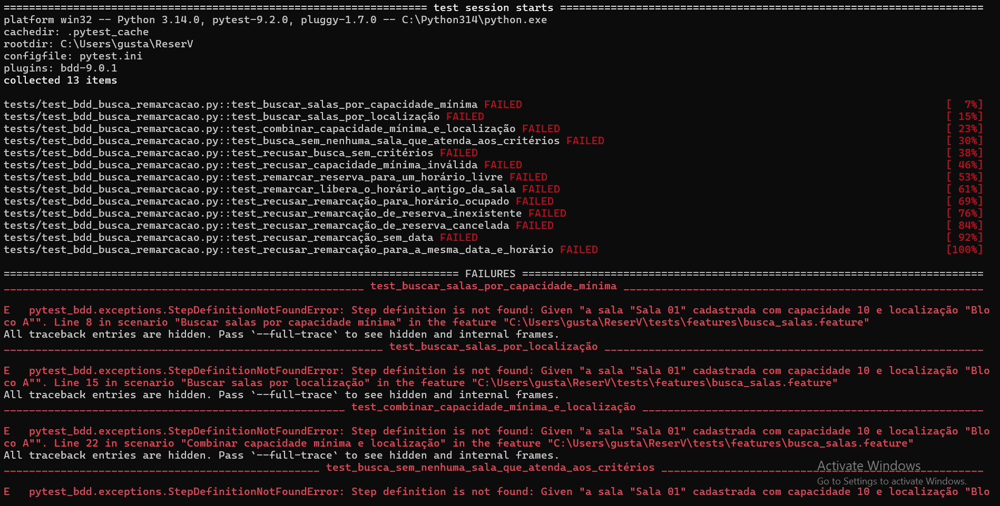 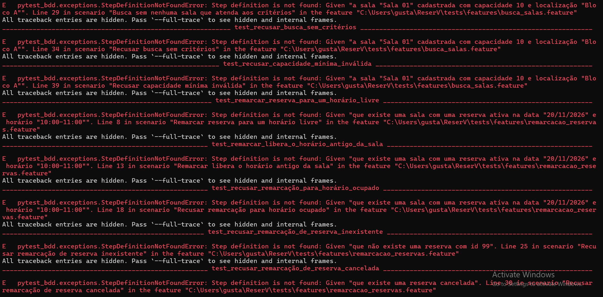 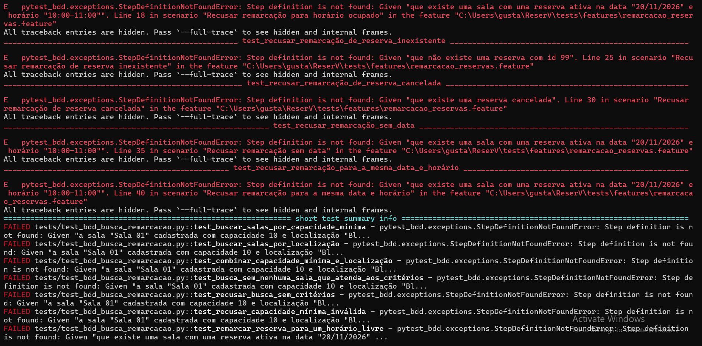 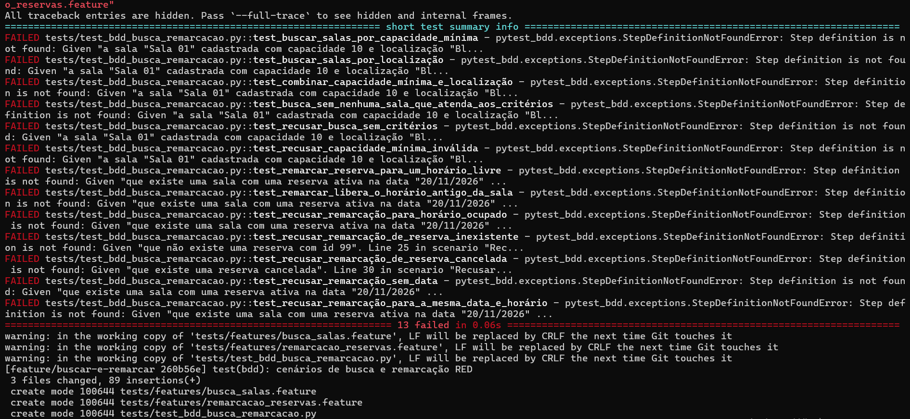 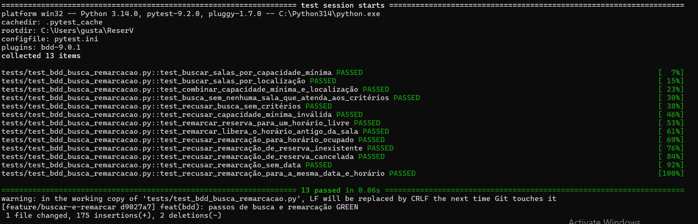

## 7. Interface de terminal

O menu do sistema recebeu duas opções do Integrante 5: **9 - Buscar salas** e **10 - Remarcar reserva**. A interface só usa `input` e `print`; as regras continuam em `src/buscas.py` e `src/remarcacao.py`. Por ser uma camada de ligação, foi validada por execução manual do programa (`python main.py`), cobrindo o cadastro de salas, a busca, a realização de uma reserva (opção 5), a remarcação (opção 10), a listagem das reservas (opção 8), a tentativa de remarcar uma reserva inexistente e a saída do sistema.

Resultados observados na etapa de remarcação:

- Reserva realizada para 20/11/2026, 10:00-11:00: `Reserva realizada com sucesso! (id 1)`.
- Remarcação para 21/11/2026, 14:00-15:00: `Reserva 1 remarcada para 21/11/2026 (14:00-15:00)!`.
- Listagem (opção 8): reserva em 21/11/2026, 14:00-15:00, status ativa.
- Reserva inexistente (id 99): `Não foi possível remarcar: Reserva não encontrada.`
- Saída (opção 0): `Encerrando o sistema.`

Evidências: 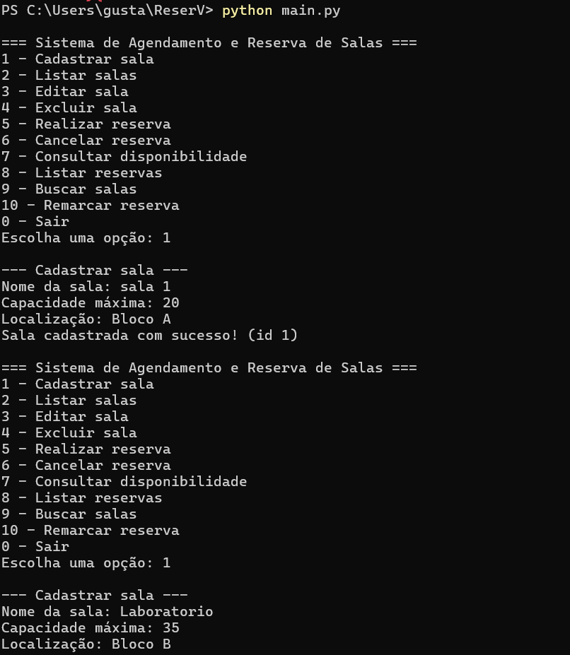 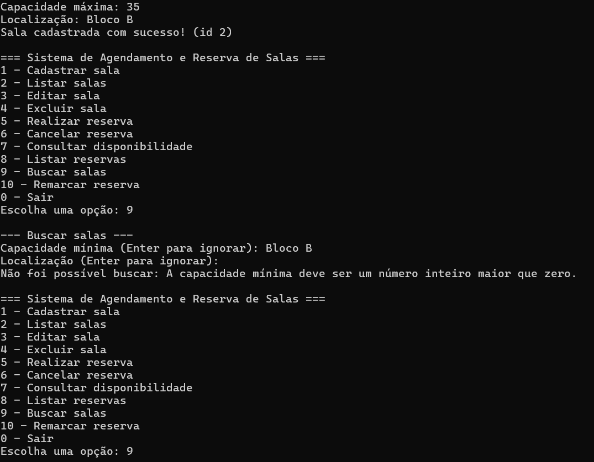 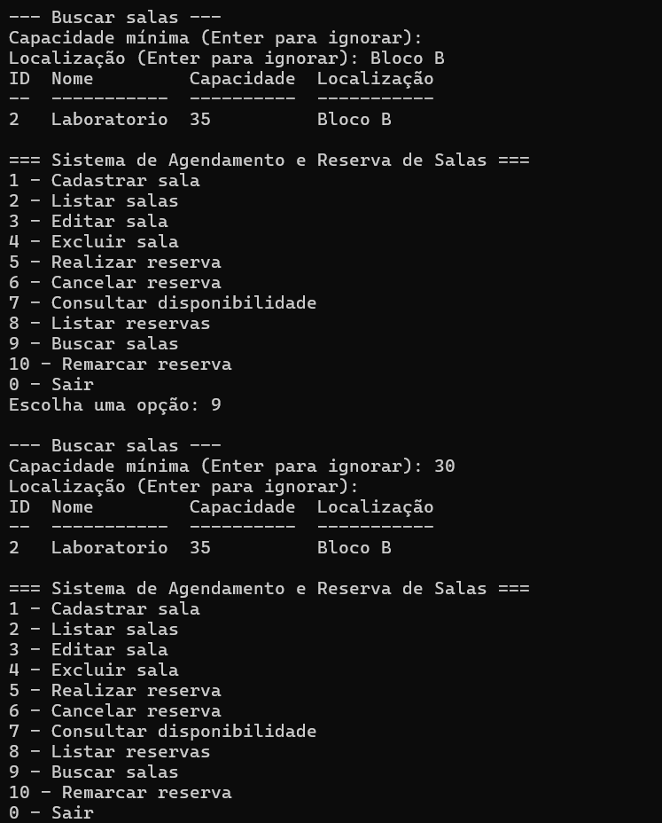 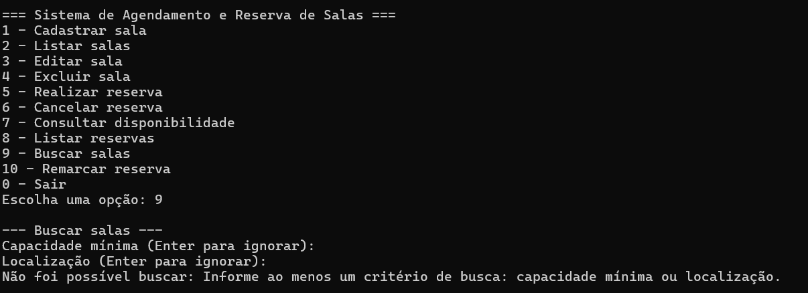 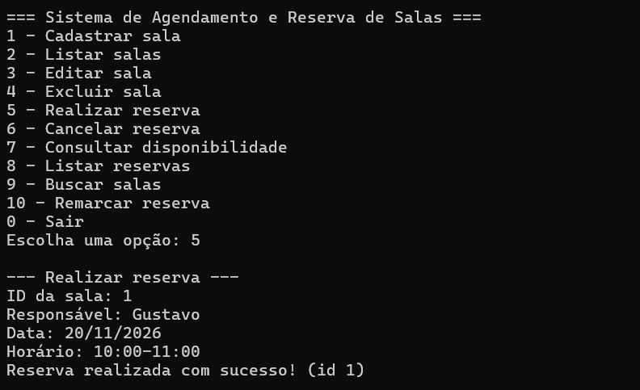 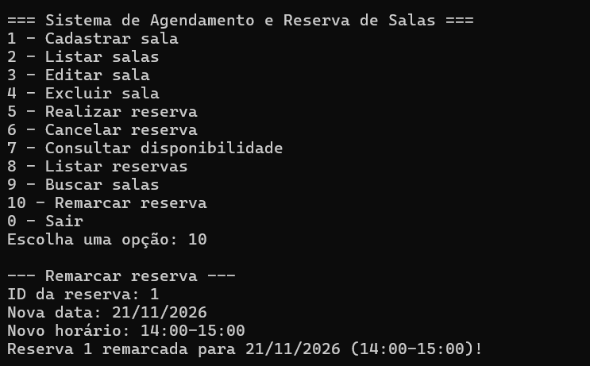 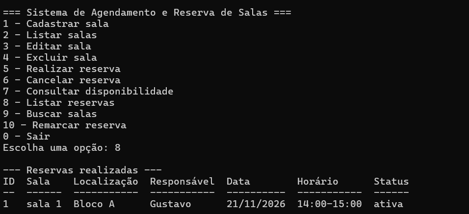 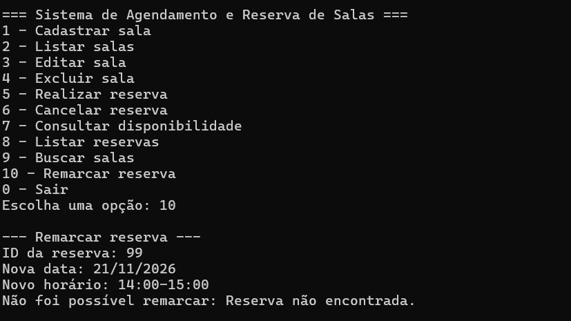

## 8. Resultado final

Suíte completa (`python -m pytest -v`): **146 testes passando**, sendo 100 anteriores aos ciclos do Integrante 5, 33 de TDD do Integrante 5 e 13 de BDD do Integrante 5.

Evidências: 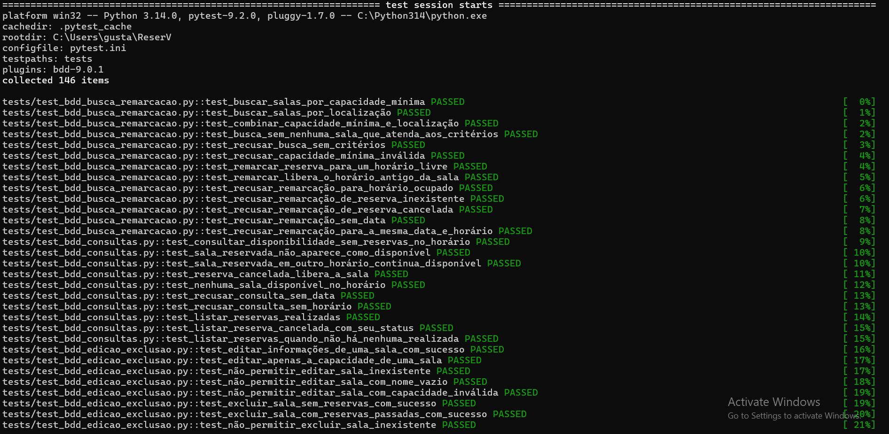 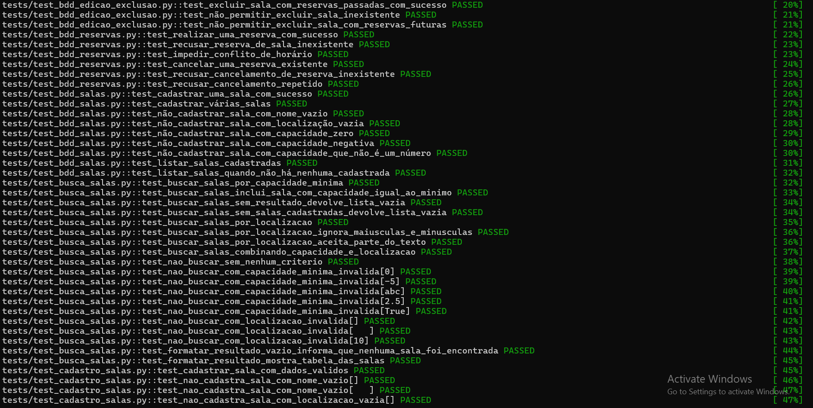 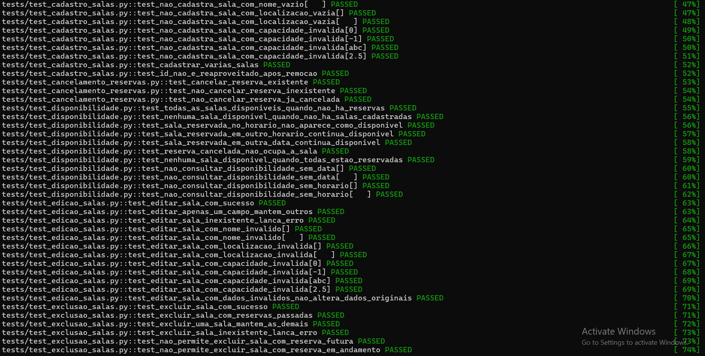 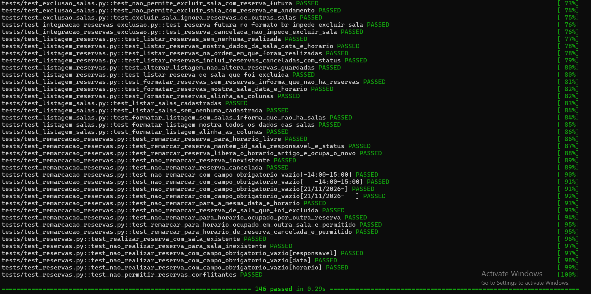

### Rastreabilidade dos requisitos

| Requisito | Teste TDD | Cenário BDD |
|---|---|---|
| Buscar salas por capacidade mínima | `test_buscar_salas_por_capacidade_minima` | Buscar salas por capacidade mínima |
| Capacidade igual ao mínimo entra no resultado | `test_buscar_salas_inclui_sala_com_capacidade_igual_ao_minimo` | Buscar salas por capacidade mínima |
| Buscar salas por localização | `test_buscar_salas_por_localizacao`, `..._ignora_maiusculas_e_minusculas`, `..._aceita_parte_do_texto` | Buscar salas por localização |
| Combinar os dois critérios | `test_buscar_salas_combinando_capacidade_e_localizacao` | Combinar capacidade mínima e localização |
| Busca sem resultado | `test_buscar_salas_sem_resultado_devolve_lista_vazia`, `test_formatar_resultado_vazio_informa_que_nenhuma_sala_foi_encontrada` | Busca sem nenhuma sala que atenda aos critérios |
| Exigir ao menos um critério | `test_nao_buscar_sem_nenhum_criterio` | Recusar busca sem critérios |
| Capacidade mínima válida | `test_nao_buscar_com_capacidade_minima_invalida` | Recusar capacidade mínima inválida |
| Resultado organizado no terminal | `test_formatar_resultado_mostra_tabela_das_salas` | Buscar salas por capacidade mínima |
| Remarcar para horário livre | `test_remarcar_reserva_para_horario_livre` | Remarcar reserva para um horário livre |
| Manter id, sala, responsável e status | `test_remarcar_reserva_mantem_id_sala_responsavel_e_status` | Remarcar reserva para um horário livre |
| Liberar o horário antigo | `test_remarcar_reserva_libera_o_horario_antigo_e_ocupa_o_novo` | Remarcar libera o horário antigo da sala |
| Recusar reserva inexistente | `test_nao_remarcar_reserva_inexistente` | Recusar remarcação de reserva inexistente |
| Recusar reserva cancelada | `test_nao_remarcar_reserva_cancelada` | Recusar remarcação de reserva cancelada |
| Campos obrigatórios | `test_nao_remarcar_com_campo_obrigatorio_vazio` | Recusar remarcação sem data |
| Recusar mesma data e horário | `test_nao_remarcar_para_a_mesma_data_e_horario` | Recusar remarcação para a mesma data e horário |
| Recusar reserva de sala excluída | `test_nao_remarcar_reserva_de_sala_que_foi_excluida` | — |
| Recusar horário ocupado | `test_nao_remarcar_para_horario_ocupado_por_outra_reserva` | Recusar remarcação para horário ocupado |
| Permitir horário de outra sala ou de reserva cancelada | `test_remarcar_para_horario_ocupado_em_outra_sala_e_permitido`, `test_remarcar_para_horario_de_reserva_cancelada_e_permitido` | — |

## 9. Integração com os demais integrantes

- **Integrante 1 (cadastro e listagem de salas):** a busca lê as salas do armazenamento compartilhado (`armazenamento.salas`) e reaproveita o formato da sala (`id`, `nome`, `capacidade`, `localizacao`).
- **Integrante 2 (editar e excluir salas):** a remarcação recusa reservas cujas salas foram excluídas, respeitando a exclusão feita por ele.
- **Integrante 3 (reservas):** a remarcação altera reservas criadas por ele, mantendo o id, a sala, o responsável e o status, e considera as reservas canceladas como horário livre.
- **Integrante 4 (consultas):** a listagem de reservas (opção 8) mostra a nova data e o novo horário depois da remarcação, e a consulta de disponibilidade enxerga o horário antigo como livre.
- **Menu:** as opções 9 e 10 foram adicionadas ao menu existente, sem alterar as opções dos outros integrantes.

## 10. Como reproduzir

```powershell
python -m venv venv
venv\Scripts\Activate.ps1
pip install pytest pytest-bdd
python -m pytest -v                                        # todos os testes
python -m pytest tests/test_busca_salas.py -v              # TDD: busca
python -m pytest tests/test_remarcacao_reservas.py -v      # TDD: remarcação
python -m pytest tests/test_bdd_busca_remarcacao.py -v     # BDD
python main.py                                             # executa o sistema
```
