# Registro de Desenvolvimento (TDD e BDD)

**Projeto:** Sistema de Agendamento e Reserva de Salas (Python, terminal)
**Integrante:** 4 — Consultas — Pedro Henrique Borges Odia
**Funcionalidades desenvolvidas:** (7) Consultar disponibilidade e (8) Listar reservas
**Data:** 15/11/2026

---

## 1. Visão geral

A parte do Integrante 4 foi desenvolvida com **TDD** (Test Driven Development) e **BDD** (Behavior Driven Development), seguindo o mesmo fluxo usado pelos demais integrantes:

1. **Red:** escrever o teste e executá-lo, comprovando que falha.
2. **Green:** escrever o mínimo de código para o teste passar.
3. **Refactor:** melhorar o código mantendo todos os testes passando.

| Ferramenta | Uso |
|---|---|
| Python | Linguagem do sistema (execução pelo terminal) |
| pytest | Testes automatizados (TDD) |
| pytest-bdd | Execução dos cenários Gherkin (BDD) |
| Git | Histórico: cada fase (Red, Green, Refactor) foi registrada em commit |

Os dados continuam **somente em memória** (`armazenamento.salas` e `armazenamento.reservas`). As consultas apenas **leem** essas listas; nenhuma das duas funcionalidades altera salas ou reservas.

---

## 2. Estrutura de arquivos

Arquivos criados ou alterados pelo Integrante 4:

```
ReserV/
├── src/
│   ├── consultas.py                     # NOVO: consultar disponibilidade, listar e formatar reservas
│   └── interface.py                     # ALTERADO: opções 7 e 8 do menu
├── tests/
│   ├── test_disponibilidade.py          # NOVO: TDD da consulta de disponibilidade
│   ├── test_listagem_reservas.py        # NOVO: TDD da listagem de reservas
│   ├── test_bdd_consultas.py            # NOVO: BDD (passos dos cenários)
│   └── features/
│       └── consultas.feature            # NOVO: cenários em Gherkin
├── README.md                            # ALTERADO: funcionalidades, menu e comandos de teste
└── docs/
    └── pedro/
        ├── registro_tdd.md              # este documento
        └── evidencias/
            ├── ciclo1/ … ciclo6/        # prints de cada fase dos ciclos TDD
            ├── bdd/                     # prints do BDD (Red e Green)
            ├── interface/               # prints do menu no terminal
            └── suite/                   # prints da suíte completa
```

---

## 3. Decisões de projeto

- **Módulo próprio:** as funções ficam em `src/consultas.py`, separadas de `salas.py` (Integrantes 1 e 2) e `reservas.py` (Integrante 3). Assim cada integrante explica o seu arquivo, e ninguém precisou alterar o código dos outros.
- **Mesma regra de ocupação da reserva:** `consultar_disponibilidade` usa a função `_existe_conflito` do Integrante 3. Uma sala está ocupada quando tem reserva **ativa** na **mesma data e mesmo horário**. Com isso, se a consulta disser que a sala está livre, a reserva nesse horário será aceita (e vice-versa). Reservas **canceladas** não ocupam a sala.
- **Mesmas validações e mensagens:** data e horário são obrigatórios. A validação reaproveita `_texto_obrigatorio` do Integrante 3, gerando as mesmas mensagens da reserva (`"O campo data é obrigatório."` e `"O campo horário é obrigatório."`).
- **Resultado da consulta no mesmo formato das salas:** a consulta devolve os próprios dicionários de sala, então o menu exibe o resultado com `formatar_listagem` (Integrante 1). Quando nenhuma sala está livre, aparece a mensagem já existente `"Não há salas disponíveis."`.
- **Listagem com informações da sala:** `listar_reservas` devolve, para cada reserva, um **novo** dicionário com `id`, `sala_id`, `sala_nome`, `sala_localizacao`, `responsavel`, `data`, `horario` e `status`. Por ser uma cópia, alterar o resultado não altera `armazenamento.reservas`.
- **Reservas canceladas aparecem na listagem** com o status `cancelada`, para manter o histórico do que foi realizado.
- **Sala excluída:** o Integrante 2 permite excluir sala que só tem reservas passadas ou canceladas. Nesse caso, a reserva antiga continua na lista e aparece como `"Sala removida"` (localização `"-"`), em vez de gerar erro.
- **Tabela de reservas:** `formatar_reservas` usa `_calcular_larguras` e `_montar_linha` do Integrante 1, então as duas tabelas do sistema têm o mesmo visual. Sem reservas, aparece `"Não há reservas realizadas."`.
- **Funções sem interface:** `consultas.py` não usa `print` nem `input`; o menu (`interface.py`) é só a camada de entrada e saída.

---

## 4. Resumo dos ciclos TDD

| Ciclo | Foco | Testes | Red | Green | Refactor |
|---|---|---|---|---|---|
| 1 | Disponibilidade sem reservas | 2 | `ModuleNotFoundError` (módulo inexistente) | 2 passed | Nenhum necessário |
| 2 | Salas ocupadas e reservas canceladas | 5 | 2 failed, 5 passed (`AssertionError`) | 7 passed | Reaproveita `_existe_conflito` |
| 3 | Data e horário obrigatórios | 4 casos | 4 failed, 7 passed (`DID NOT RAISE ValueError`) | 11 passed | Reaproveita `_texto_obrigatorio` |
| 4 | Listagem de reservas com dados da sala | 5 | `ImportError` (função inexistente) | 5 passed | Nenhum necessário |
| 5 | Reserva de sala excluída | 1 | 1 failed, 5 passed (`StopIteration`) | 6 passed | `_buscar_sala` e `_montar_item_reserva` |
| 6 | Formatação da listagem de reservas | 3 | `ImportError` (função inexistente) | 9 passed | Reaproveita `_calcular_larguras` e `_montar_linha` |

Total de testes TDD: **20** (11 em `test_disponibilidade.py` e 9 em `test_listagem_reservas.py`).
Total de cenários BDD: **10**.
Total de testes do Integrante 4: **30**.

---

## 5. Detalhamento dos ciclos TDD

### Ciclo 1 — Disponibilidade sem reservas

- **Testes** (`tests/test_disponibilidade.py`):
  - `test_todas_as_salas_disponiveis_quando_nao_ha_reservas`: com duas salas cadastradas e nenhuma reserva, as duas aparecem como disponíveis;
  - `test_nenhuma_sala_disponivel_quando_nao_ha_salas_cadastradas`: sem salas, a consulta devolve lista vazia.
- **Red:** `ModuleNotFoundError: No module named 'src.consultas'`. O módulo ainda não existia.
- **Green:** criado `src/consultas.py` com `consultar_disponibilidade(data, horario)` devolvendo uma cópia de todas as salas (o mínimo para os dois testes). Resultado: 2 passed.
- **Refactor:** nada a melhorar nesta etapa.

Evidências:
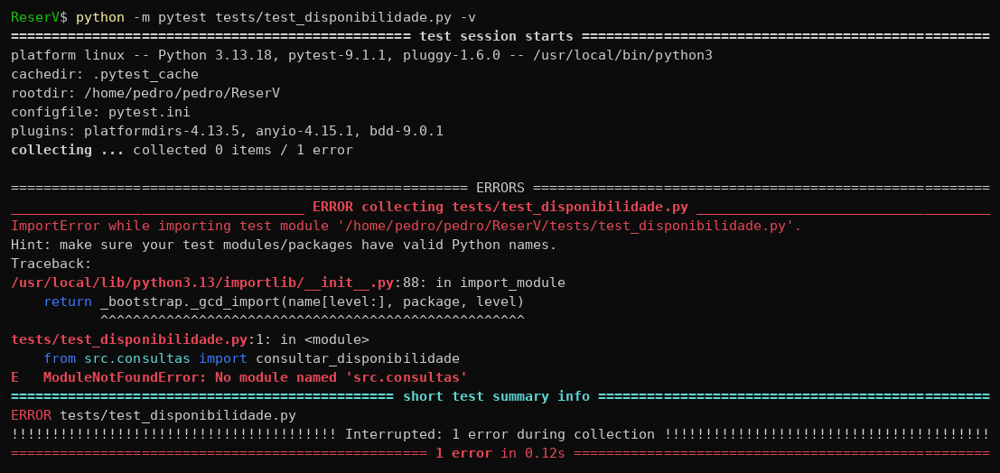
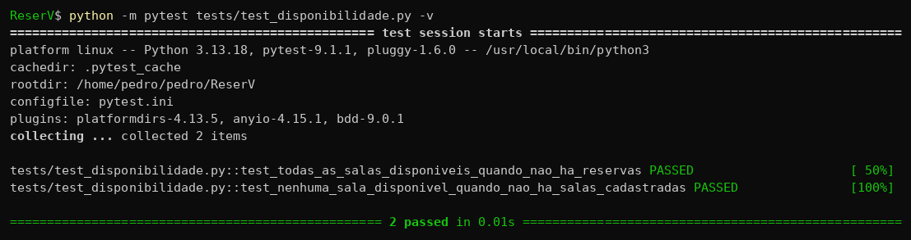

---

### Ciclo 2 — Salas ocupadas e reservas canceladas

- **Testes:**
  - `test_sala_reservada_no_horario_nao_aparece_como_disponivel`: a sala com reserva ativa na data e horário consultados some do resultado;
  - `test_sala_reservada_em_outro_horario_continua_disponivel`;
  - `test_sala_reservada_em_outra_data_continua_disponivel`;
  - `test_reserva_cancelada_nao_ocupa_a_sala`;
  - `test_nenhuma_sala_disponivel_quando_todas_estao_reservadas`.
- **Red:** 2 failed, 5 passed. Os testes de sala ocupada falharam com `AssertionError`, porque a função ainda devolvia todas as salas. Os outros três já passavam e documentam o comportamento esperado.
- **Green:** para cada sala, um laço percorre as reservas e marca a sala como ocupada quando encontra reserva ativa com o mesmo `sala_id`, `data` e `horario`. Resultado: 7 passed.
- **Refactor:** o laço repetia a regra de conflito já implementada pelo Integrante 3. Ele foi trocado por uma *list comprehension* que usa `_existe_conflito(sala_id, data, horario)` de `src/reservas.py`. Assim, consulta e reserva usam exatamente a mesma regra. 7 passed.

Evidências:
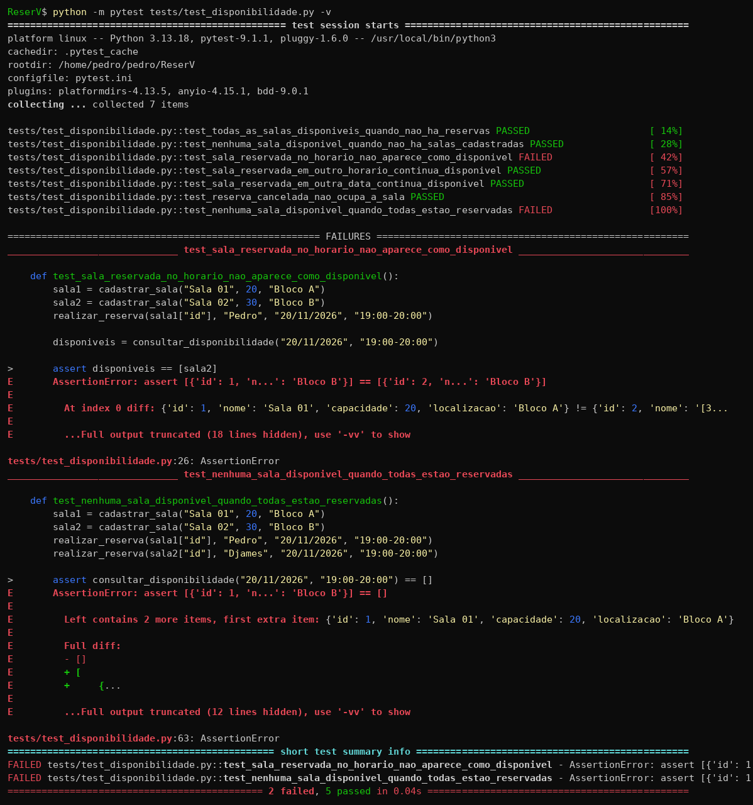
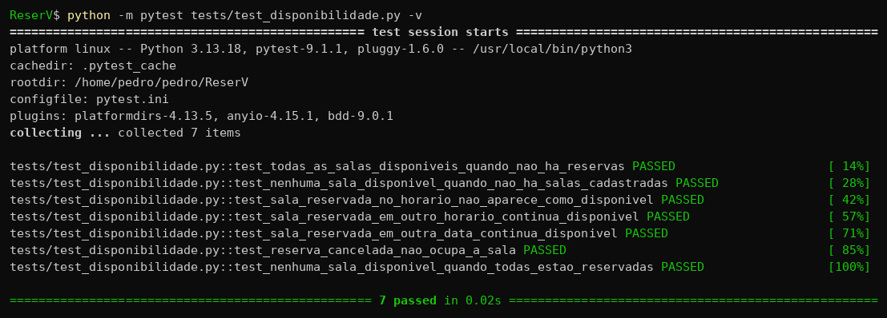


---

### Ciclo 3 — Data e horário obrigatórios

- **Testes:**
  - `test_nao_consultar_disponibilidade_sem_data` (casos: `""` e `"   "`);
  - `test_nao_consultar_disponibilidade_sem_horario` (casos: `""` e `"   "`).
  Cada um exige `ValueError` com o nome do campo na mensagem.
- **Red:** 4 failed, 7 passed, com `Failed: DID NOT RAISE ValueError`. A consulta aceitava data e horário vazios.
- **Green:** duas verificações no início da função, levantando `"O campo data é obrigatório."` e `"O campo horário é obrigatório."`. Resultado: 11 passed.
- **Refactor:** as verificações foram substituídas por `_texto_obrigatorio(data, "data")` e `_texto_obrigatorio(horario, "horário")`, a mesma função usada em `realizar_reserva`. 11 passed.

Evidências:
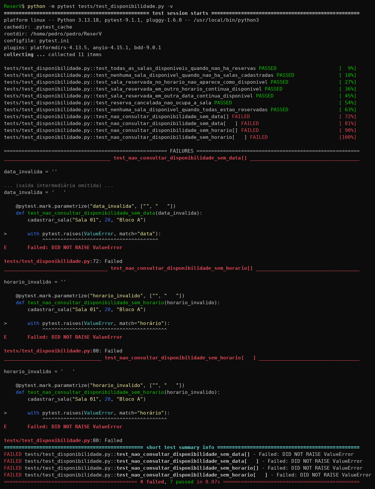
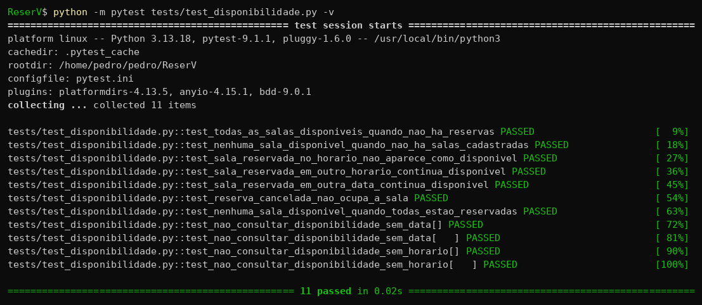


---

### Ciclo 4 — Listagem de reservas com dados da sala

- **Testes** (`tests/test_listagem_reservas.py`):
  - `test_listar_reservas_sem_nenhuma_realizada`: sem reservas, devolve lista vazia;
  - `test_listar_reservas_mostra_dados_da_sala_data_e_horario`: cada item traz nome e localização da sala, responsável, data, horário e status;
  - `test_listar_reservas_na_ordem_em_que_foram_realizadas`;
  - `test_listar_reservas_inclui_reservas_canceladas_com_status`;
  - `test_alterar_listagem_nao_altera_reservas_guardadas`: o resultado é uma cópia.
- **Red:** `ImportError: cannot import name 'listar_reservas' from 'src.consultas'`.
- **Green:** criada `listar_reservas()`, que percorre `armazenamento.reservas`, busca a sala de cada uma e monta um novo dicionário com os dados da reserva e da sala. Resultado: 5 passed.
- **Refactor:** nada a melhorar nesta etapa.

Evidências:
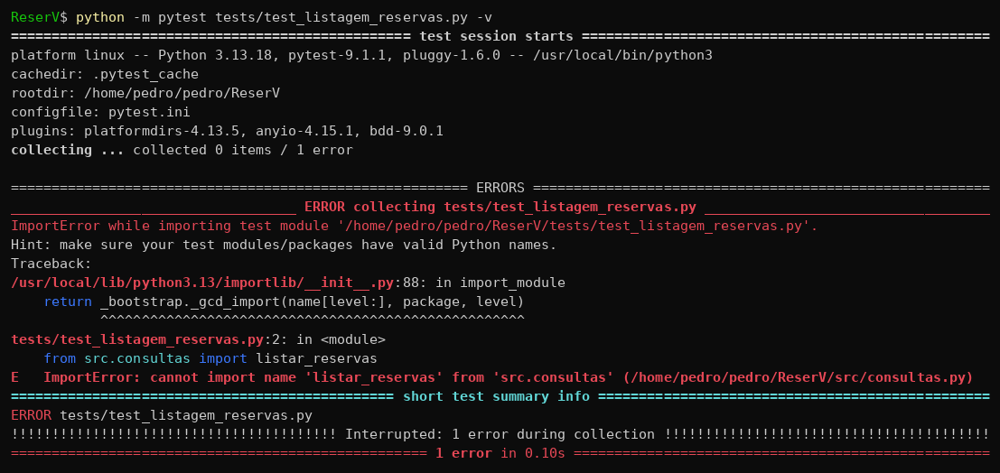
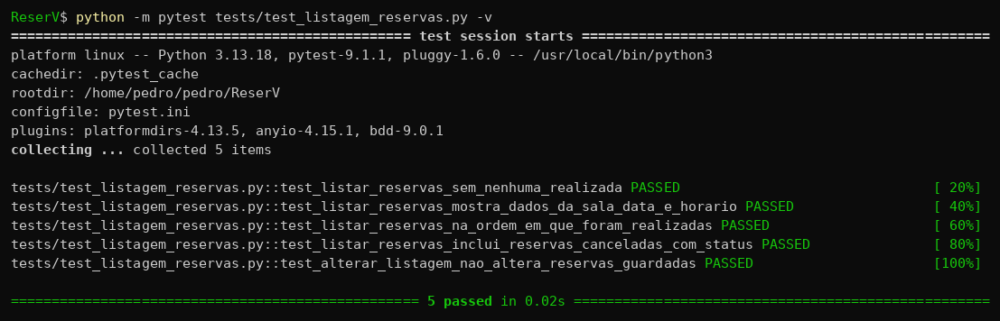

---

### Ciclo 5 — Reserva de sala excluída

- **Teste:** `test_listar_reserva_de_sala_que_foi_excluida`. Cadastra uma sala, faz uma reserva no passado (`10/01/2025`), exclui a sala (permitido pelo Integrante 2, pois não há reserva futura) e lista as reservas. Exige que a reserva continue listada com `sala_nome == "Sala removida"` e `sala_localizacao == "-"`.
- **Red:** 1 failed, 5 passed, com `StopIteration`. A busca da sala não encontrava nada e quebrava a listagem.
- **Green:** a busca com `next(...)` passou a ter um valor padrão `{"nome": "Sala removida", "localizacao": "-"}`. Resultado: 6 passed.
- **Refactor:** o valor padrão virou a constante `SALA_REMOVIDA`; a busca foi para `_buscar_sala(sala_id)` e a montagem de cada item para `_montar_item_reserva(reserva)`. Com isso, `listar_reservas` ficou com uma linha. 6 passed.

Evidências:
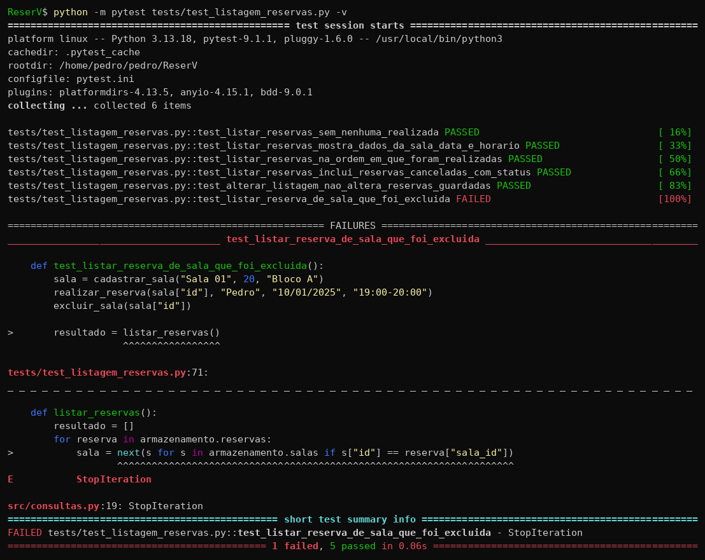
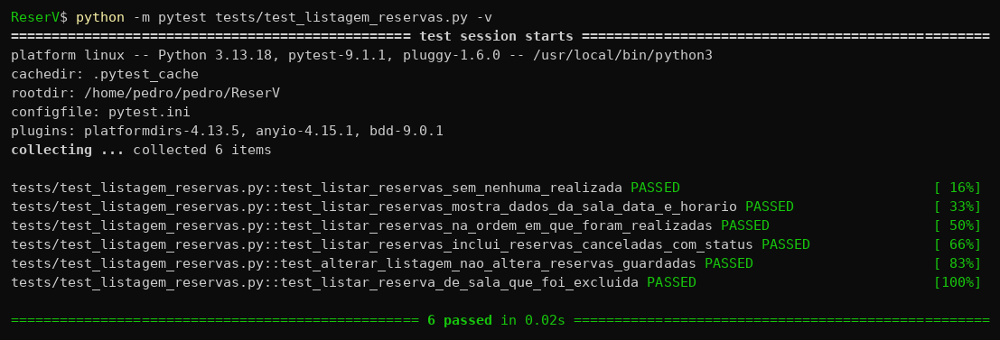


---

### Ciclo 6 — Formatação da listagem de reservas

- **Testes:**
  - `test_formatar_reservas_sem_reservas_informa_que_nao_ha_reservas`;
  - `test_formatar_reservas_mostra_sala_data_e_horario` (cabeçalho, separador e uma linha por reserva);
  - `test_formatar_reservas_alinha_as_colunas` (nome de sala longo ao lado de um curto).
- **Red:** `ImportError: cannot import name 'formatar_reservas' from 'src.consultas'`.
- **Green:** criada `formatar_reservas`, com cálculo próprio da largura das colunas e montagem das linhas. Resultado: 9 passed.
- **Refactor:** o cálculo das larguras e a montagem das linhas repetiam o que o Integrante 1 já tinha feito na listagem de salas. O código passou a usar `_calcular_larguras` e `_montar_linha` de `src/salas.py`; os títulos foram para a constante `TITULOS_RESERVAS` e a conversão de cada reserva em colunas para `_linha_reserva`. 9 passed.

Evidências:
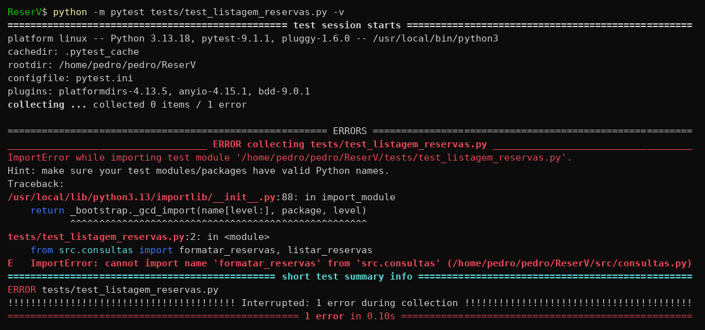
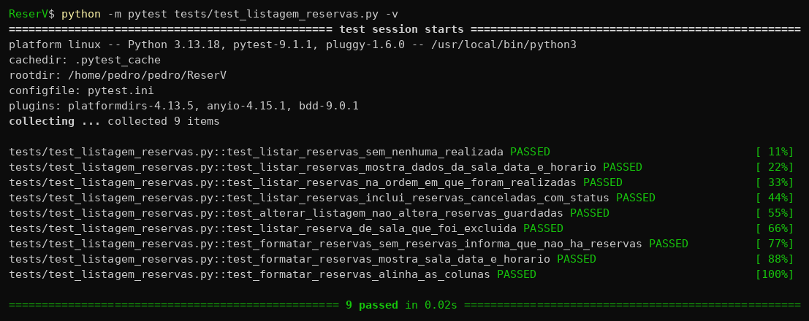


Exemplo de saída da listagem de reservas:

```
ID  Sala                        Localização  Responsável  Data        Horário      Status
--  --------------------------  -----------  -----------  ----------  -----------  ---------
1   Sala 01                     Bloco A      Pedro        20/11/2026  19:00-20:00  cancelada
2   Laboratório de Informática  Bloco B      Djames       21/11/2026  08:00-10:00  ativa
```

---

## 6. BDD (Gherkin com pytest-bdd)

Arquivo `tests/features/consultas.feature`, em português (`# language: pt`), com **10 cenários**:

| Tipo | Funcionalidade | Cenário |
|---|---|---|
| Positivo | Disponibilidade | Consultar disponibilidade sem reservas no horário |
| Positivo | Disponibilidade | Sala reservada não aparece como disponível |
| Alternativo | Disponibilidade | Sala reservada em outro horário continua disponível |
| Alternativo | Disponibilidade | Reserva cancelada libera a sala |
| Alternativo | Disponibilidade | Nenhuma sala disponível no horário |
| Negativo | Disponibilidade | Recusar consulta sem data |
| Negativo | Disponibilidade | Recusar consulta sem horário |
| Positivo | Listagem | Listar reservas realizadas |
| Alternativo | Listagem | Listar reserva cancelada com seu status |
| Alternativo | Listagem | Listar reservas quando não há nenhuma realizada |

Exemplo de cenário:

```gherkin
Cenário: Sala reservada não aparece como disponível
  Dado que existem as salas "Sala 01" e "Sala 02" cadastradas
  E a sala "Sala 01" está reservada na data "20/11/2026" e horário "19:00-20:00"
  Quando consulto a disponibilidade na data "20/11/2026" e horário "19:00-20:00"
  Então apenas a sala "Sala 02" deve estar disponível
```

- **Red:** com apenas `scenarios("features/consultas.feature")` em `tests/test_bdd_consultas.py`, os 10 cenários falharam com `StepDefinitionNotFoundError`: o comportamento estava descrito, mas ainda sem automação.
- **Green:** implementados os passos (`@given`, `@when`, `@then`) em `tests/test_bdd_consultas.py`, ligando as frases a `consultar_disponibilidade`, `listar_reservas`, `formatar_reservas` e `formatar_listagem`. Os passos de "Dado" usam as funções reais de cadastro, reserva e cancelamento dos outros integrantes. Resultado: 10 passed.
- **Refactor:** o passo de consulta usa `parsers.re` para aceitar data ou horário vazios (`""`), assim um único passo atende os cenários positivos e negativos. Nenhuma outra alteração foi necessária.

Evidências:
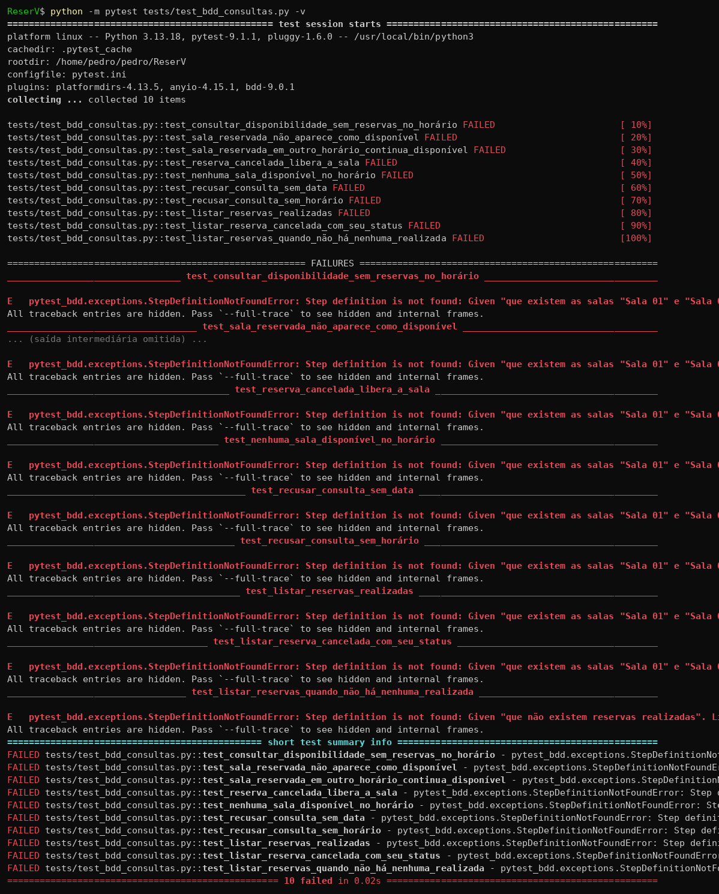
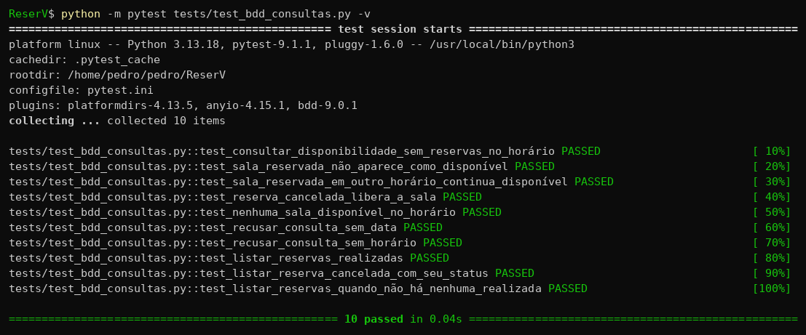

---

## 7. Interface de terminal

Em `src/interface.py`, foram adicionadas:

- `opcao_consultar_disponibilidade()`: pede data e horário, chama `consultar_disponibilidade` e mostra as salas livres com `formatar_listagem`. Erros de validação aparecem como `"Não foi possível consultar: ..."`.
- `opcao_listar_reservas()`: mostra a tabela de `formatar_reservas(listar_reservas())`.
- `exibir_menu()` e `executar()`: novas opções `7 - Consultar disponibilidade` e `8 - Listar reservas`.

A interface foi validada executando o programa com este roteiro: cadastro de duas salas, reserva da Sala 01, consulta de disponibilidade (só o Laboratório aparece), consulta sem data (recusada), segunda reserva, cancelamento da primeira, listagem de reservas (com os status `cancelada` e `ativa`) e nova consulta (a Sala 01 volta a ficar livre). Nos prints, o que foi digitado aparece em amarelo.

Evidências:
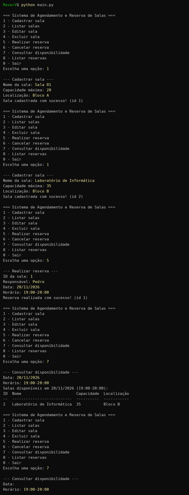
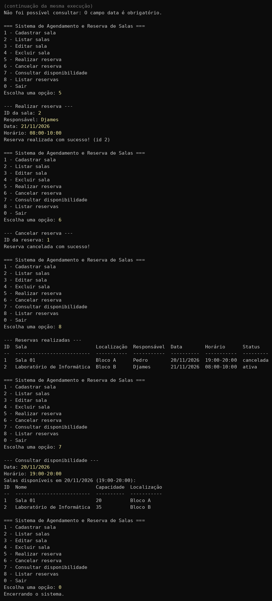

---

## 8. Resultado final

A suíte completa (`python -m pytest -v`) tem **100 testes passando**: 70 dos Integrantes 1, 2 e 3 e 30 do Integrante 4. Nenhum teste dos outros integrantes precisou ser alterado.

Evidências:
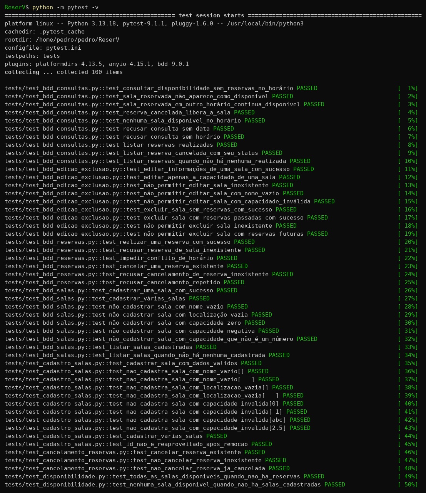
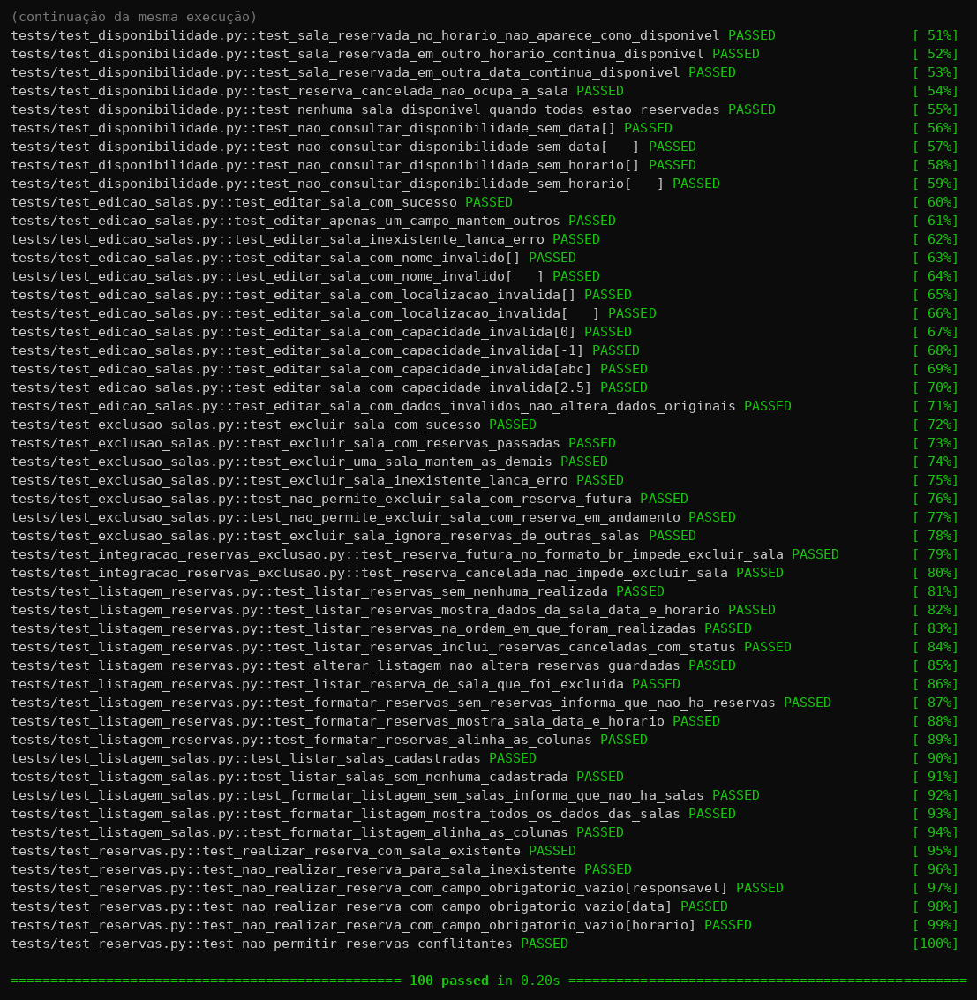

### Rastreabilidade dos requisitos

| Requisito | Teste TDD | Cenário BDD |
|---|---|---|
| Consultar salas disponíveis em uma data e horário | `test_todas_as_salas_disponiveis_quando_nao_ha_reservas` | Consultar disponibilidade sem reservas no horário |
| Sala reservada no horário não está disponível | `test_sala_reservada_no_horario_nao_aparece_como_disponivel` | Sala reservada não aparece como disponível |
| Reserva em outro horário ou data não ocupa a sala | `test_sala_reservada_em_outro_horario_continua_disponivel`, `test_sala_reservada_em_outra_data_continua_disponivel` | Sala reservada em outro horário continua disponível |
| Reserva cancelada não ocupa a sala | `test_reserva_cancelada_nao_ocupa_a_sala` | Reserva cancelada libera a sala |
| Informar quando não há salas livres | `test_nenhuma_sala_disponivel_quando_todas_estao_reservadas`, `test_nenhuma_sala_disponivel_quando_nao_ha_salas_cadastradas` | Nenhuma sala disponível no horário |
| Data e horário obrigatórios | `test_nao_consultar_disponibilidade_sem_data`, `test_nao_consultar_disponibilidade_sem_horario` | Recusar consulta sem data, Recusar consulta sem horário |
| Listar reservas com sala, data e horário | `test_listar_reservas_mostra_dados_da_sala_data_e_horario`, `test_listar_reservas_na_ordem_em_que_foram_realizadas` | Listar reservas realizadas |
| Mostrar status das reservas | `test_listar_reservas_inclui_reservas_canceladas_com_status` | Listar reserva cancelada com seu status |
| Mensagem quando não há reservas | `test_listar_reservas_sem_nenhuma_realizada`, `test_formatar_reservas_sem_reservas_informa_que_nao_ha_reservas` | Listar reservas quando não há nenhuma realizada |
| Listagem não altera os dados guardados | `test_alterar_listagem_nao_altera_reservas_guardadas` | — |
| Reserva de sala excluída não quebra a listagem | `test_listar_reserva_de_sala_que_foi_excluida` | — |
| Dados organizados em tabela no terminal | `test_formatar_reservas_mostra_sala_data_e_horario`, `test_formatar_reservas_alinha_as_colunas` | Listar reservas realizadas |

---

## 9. Integração com os demais integrantes

- **Integrante 1 (cadastro e listagem):** o resultado da consulta é exibido com `formatar_listagem`, e a tabela de reservas usa `_calcular_larguras` e `_montar_linha`.
- **Integrante 2 (edição e exclusão):** uma edição de nome ou localização já aparece na próxima listagem de reservas, pois os dados da sala são buscados na hora. Reservas de salas excluídas aparecem como "Sala removida".
- **Integrante 3 (reservas):** a consulta usa `_existe_conflito` e `_texto_obrigatorio`, então consulta e reserva seguem a mesma regra e as mesmas mensagens.
- **Menu:** foram adicionadas apenas as opções 7 e 8 em `src/interface.py`, sem alterar as opções existentes.

## 10. Como reproduzir

```powershell
python -m venv venv
venv\Scripts\Activate.ps1
pip install -r requirements.txt
python -m pytest -v                                  # todos os testes
python -m pytest tests/test_disponibilidade.py -v    # TDD: disponibilidade
python -m pytest tests/test_listagem_reservas.py -v  # TDD: listagem de reservas
python -m pytest tests/test_bdd_consultas.py -v      # BDD: consultas
python main.py                                       # executa o sistema
```
