# Registro de Desenvolvimento (TDD e BDD)

**Projeto:** Sistema de Agendamento e Reserva de Salas (Python, terminal)  
**Integrante:** 2 — Edição e Exclusão de salas — Vitor  
**Funcionalidades desenvolvidas:** (3) Editar sala e (4) Excluir sala  
**Data:** 15/11/2026  

---

## 1. Visão geral

A parte do Integrante 2 foi desenvolvida rigorosamente com **TDD** (Test Driven Development) e **BDD** (Behavior Driven Development), seguindo o fluxo contínuo:

1. **Red:** escrever o teste e executá-lo, comprovando que falha (ou que o recurso ainda não existe).
2. **Green:** escrever o código estritamente necessário para fazer o teste passar.
3. **Refactor:** refatorar e aprimorar a legibilidade, eliminando duplicações e garantindo 100% dos testes passando.

| Ferramenta | Uso |
|---|---|
| Python | Linguagem do sistema (execução pelo terminal) |
| pytest | Testes unitários e de integração (TDD) |
| pytest-bdd | Execução dos cenários Gherkin (BDD) |
| Git | Controle de versão |

Os dados ficam **somente em memória**, em listas e dicionários nativos do Python (`armazenamento.salas` e `armazenamento.reservas`).

---

## 2. Estrutura de arquivos

```
ReserV/
├── main.py                                  # ponto de entrada (python3 main.py)
├── pytest.ini                               # configuração do pytest
├── requirements.txt                         # dependências
├── src/
│   ├── __init__.py
│   ├── armazenamento.py                     # salas e reservas em memória
│   ├── salas.py                             # regras de negócio: cadastrar, listar, editar, excluir
│   └── interface.py                         # menu interativo do terminal
├── tests/
│   ├── __init__.py
│   ├── conftest.py                          # fixtures automáticas de limpeza
│   ├── test_cadastro_salas.py               # TDD: cadastro (Integrante 1)
│   ├── test_listagem_salas.py               # TDD: listagem (Integrante 1)
│   ├── test_edicao_salas.py                 # TDD: edição (Integrante 2)
│   ├── test_exclusao_salas.py               # TDD: exclusão (Integrante 2)
│   ├── test_bdd_salas.py                    # BDD: cadastro/listagem (Integrante 1)
│   ├── test_bdd_edicao_exclusao.py          # BDD: edição/exclusão (Integrante 2)
│   └── features/
│       ├── cadastro_salas.feature           # cenários em Gherkin (Integrante 1)
│       └── edicao_exclusao_salas.feature    # cenários em Gherkin (Integrante 2)
└── docs/
    ├── registro_tdd.md                      # registro do Integrante 1
    ├── evidencias/                          # prints do Integrante 1
    └── vitor/
        ├── registro_tdd.md                  # este documento (Integrante 2)
        └── evidencias/                      # prints dos ciclos do Integrante 2
            ├── ciclo1/                      # prints do Ciclo 1 (Red e Green)
            ├── ciclo2/                      # prints do Ciclo 2 (Red, Green e Refactor)
            ├── ciclo3/                      # prints do Ciclo 3 (Red e Green)
            ├── ciclo4/                      # prints do Ciclo 4 (Red, Green e Refactor)
            ├── bdd/                         # prints do BDD (Red e Green)
            ├── interface/                   # prints do menu interativo no terminal
            └── suite/                       # prints da suíte completa de testes
```

---

## 3. Decisões de projeto

- **Busca por identificador único:** Criada a função `buscar_sala_por_id(id_sala)` em `src/salas.py`, que levanta `ValueError("Sala não encontrada.")` caso o ID não exista. Ela centraliza a recuperação de sala para edição e exclusão.
- **Edição pontual ou completa:** A função `editar_sala(id_sala, nome=None, capacidade=None, localizacao=None)` permite alterar todos os campos ou apenas campos específicos (como só a capacidade ou só o nome), mantendo os demais valores inalterados caso não sejam fornecidos.
- **Imutabilidade do ID:** O `id` da sala nunca é alterado durante a edição.
- **Validação atômica:** Na edição, todos os novos campos são validados antes de qualquer alteração ser aplicada. Se uma validação falhar (ex: capacidade inválida), nenhum dado da sala é alterado.
- **Controle de exclusão por reservas futuras:**
  - `armazenamento.reservas` armazena as reservas do sistema.
  - Uma sala só pode ser removida se **não possuir reservas futuras** (`data >= agora`).
  - Salas com reservas passadas podem ser excluídas com segurança.
  - A exclusão de uma sala não reaproveita o ID em novos cadastros (`_proximo_id` do Integrante 1 é preservado).

---

## 4. Resumo dos ciclos TDD

| Ciclo | Foco | Testes | Red | Green | Refactor |
|---|---|---|---|---|---|
| 1 | Edição com dados válidos | 2 | `ImportError: cannot import name 'editar_sala'` | 2 passed | Estruturação de busca |
| 2 | Validações na edição de sala | 10 casos | 10 failed, 2 passed (`DID NOT RAISE ValueError`) | 12 passed | Extração de `buscar_sala_por_id` |
| 3 | Exclusão de sala com sucesso | 3 | `ImportError: cannot import name 'excluir_sala'` | 3 passed | Adição de `reservas = []` em armazenamento |
| 4 | Regras e bloqueio de exclusão | 4 | 2 failed, 5 passed (`DID NOT RAISE ValueError`) | 7 passed | Extração de `_tem_reservas_futuras` |

Total de novos testes TDD: **19**.  
Total de novos testes BDD: **9**.  
Total de novos testes do Integrante 2: **28**.

---

## 5. Detalhamento dos ciclos TDD

### Ciclo 1 — Edição com dados válidos

- **Testes desenvolvidos:**
  - `test_editar_sala_com_sucesso`: atualiza nome, capacidade e localização de uma sala existente, garantindo a atualização em `armazenamento.salas` e a conservação do ID original.
  - `test_editar_apenas_um_campo_mantem_outros`: altera apenas um campo (ex.: capacidade), mantendo os outros campos da sala inalterados.
- **Red:** `ImportError: cannot import name 'editar_sala' from 'src.salas'`.
- **Green:** Implementação inicial da função `editar_sala` em `src/salas.py`.
- **Refactor:** Validação dos parâmetros nomeados opcionais.

Evidências:  
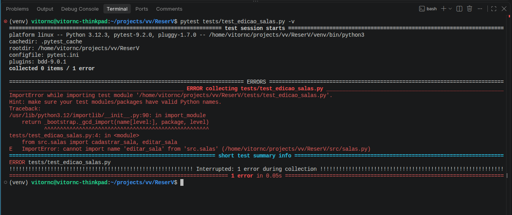  
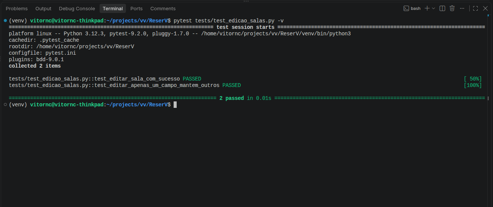

---

### Ciclo 2 — Validações na edição de sala

- **Testes desenvolvidos:**
  - `test_editar_sala_inexistente_lanca_erro`: exige `ValueError("Sala não encontrada.")` ao tentar editar um ID inexistente.
  - `test_editar_sala_com_nome_invalido`: casos `""` e `"   "` exigem `ValueError`.
  - `test_editar_sala_com_localizacao_invalida`: casos `""` e `"   "` exigem `ValueError`.
  - `test_editar_sala_com_capacidade_invalida`: casos `0`, `-1`, `"abc"` e `2.5` exigem `ValueError`.
  - `test_editar_sala_com_dados_invalidos_nao_altera_dados_originais`: garante que os dados da sala fiquem intocados caso ocorra erro de validação.
- **Red:** 10 falhas com `Failed: DID NOT RAISE ValueError`.
- **Green:** Aplicação de `_texto_preenchido` e `_capacidade_valida` em `editar_sala` antes de persistir as mudanças.
- **Refactor:** Criação da função reutilizável `buscar_sala_por_id(id_sala)`.

Evidências:  
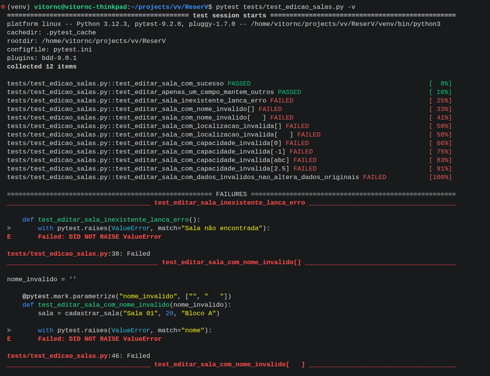  
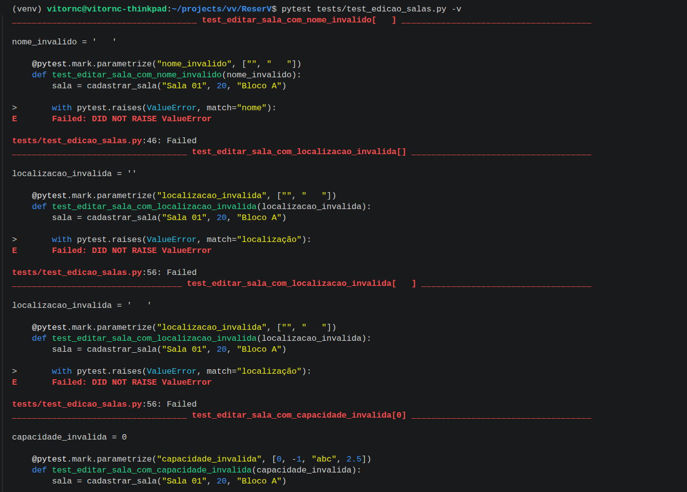  
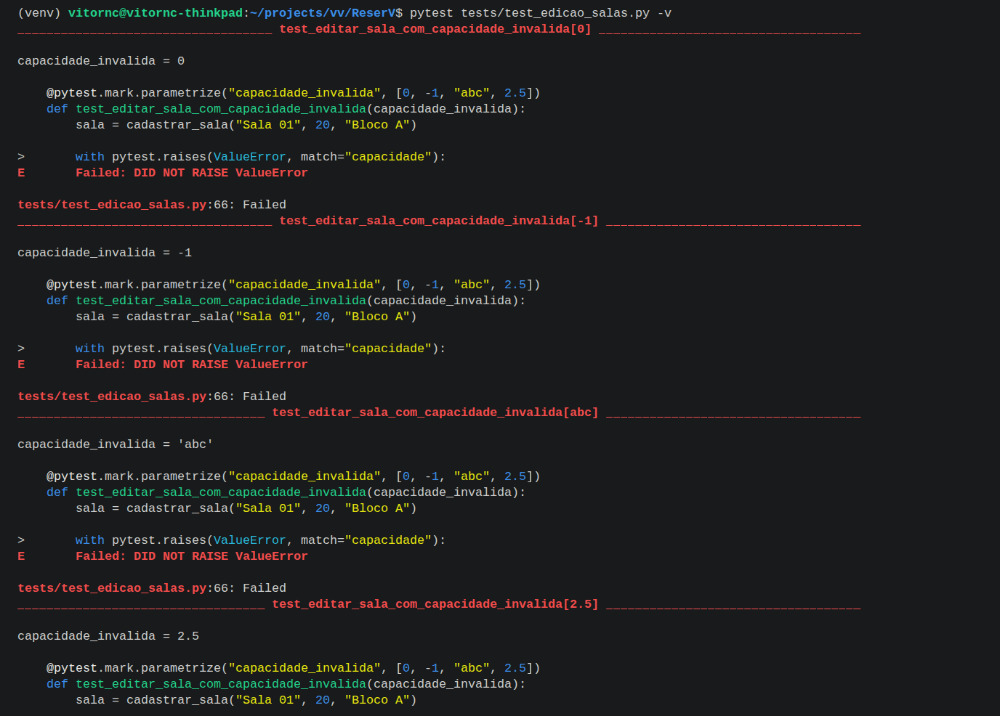  
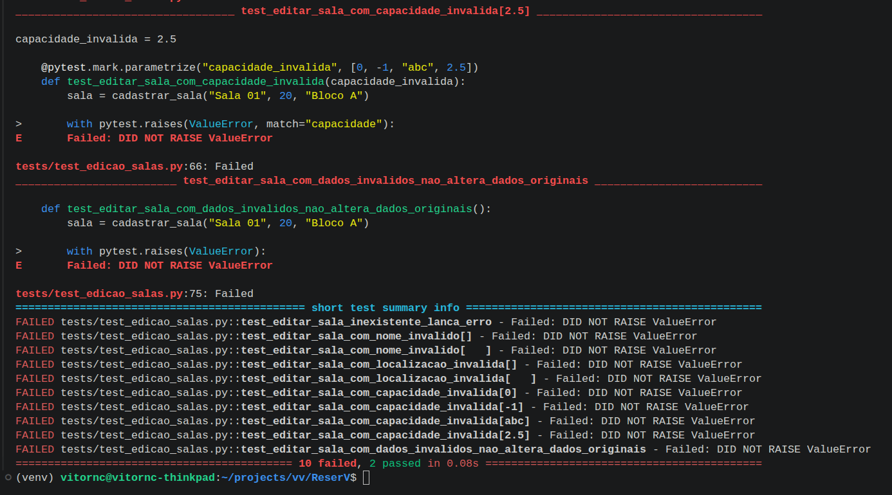  
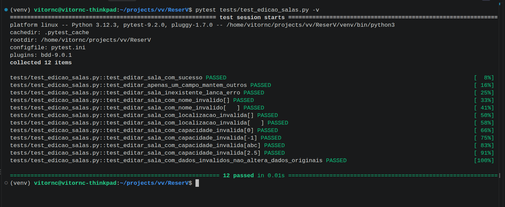  


---

### Ciclo 3 — Exclusão de sala com sucesso

- **Testes desenvolvidos:**
  - `test_excluir_sala_com_sucesso`: remove uma sala existente sem reservas do sistema.
  - `test_excluir_sala_com_reservas_passadas`: permite a remoção de uma sala que possui apenas reservas no passado.
  - `test_excluir_uma_sala_mantem_as_demais`: certifica que a exclusão da sala não afeta as demais salas cadastradas.
- **Red:** `ImportError: cannot import name 'excluir_sala' from 'src.salas'`.
- **Green:** Definição da lista `reservas = []` em `src/armazenamento.py` e implementação básica de `excluir_sala` removendo o objeto da lista.
- **Refactor:** Limpeza e garantia de reset na fixture `limpar_armazenamento`.

Evidências:  
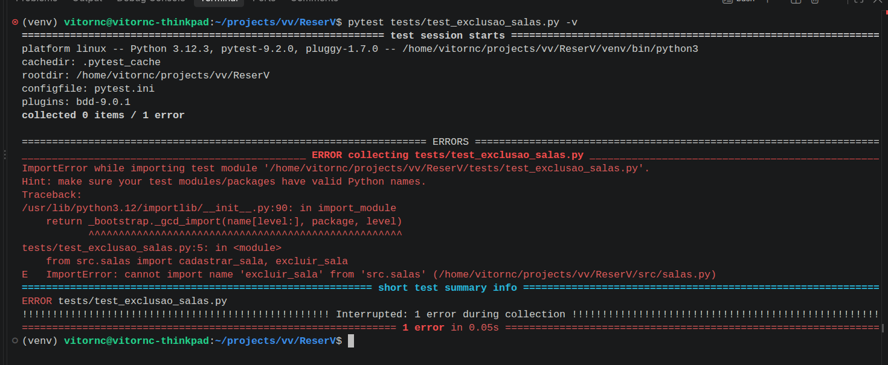  
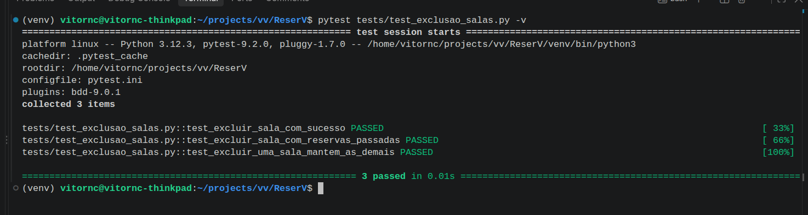

---

### Ciclo 4 — Validações e bloqueio de exclusão por reservas futuras

- **Testes desenvolvidos:**
  - `test_excluir_sala_inexistente_lanca_erro`: tentar excluir ID inexistente levanta `ValueError("Sala não encontrada.")`.
  - `test_nao_permite_excluir_sala_com_reserva_futura`: sala com reserva futura levanta `ValueError` e permanece cadastrada.
  - `test_nao_permite_excluir_sala_com_reserva_em_andamento`: sala com reserva em andamento não pode ser excluída.
  - `test_excluir_sala_ignora_reservas_de_outras_salas`: reservas futuras em outras salas não bloqueiam a exclusão da sala alvo.
- **Red:** Falha nos testes de reserva futura com `Failed: DID NOT RAISE ValueError`.
- **Green:** Implementação da verificação de datas futuras comparadas com o instante atual (`datetime.now()`).
- **Refactor:** Modularização na função auxiliar `_tem_reservas_futuras(id_sala)`.

Evidências:  
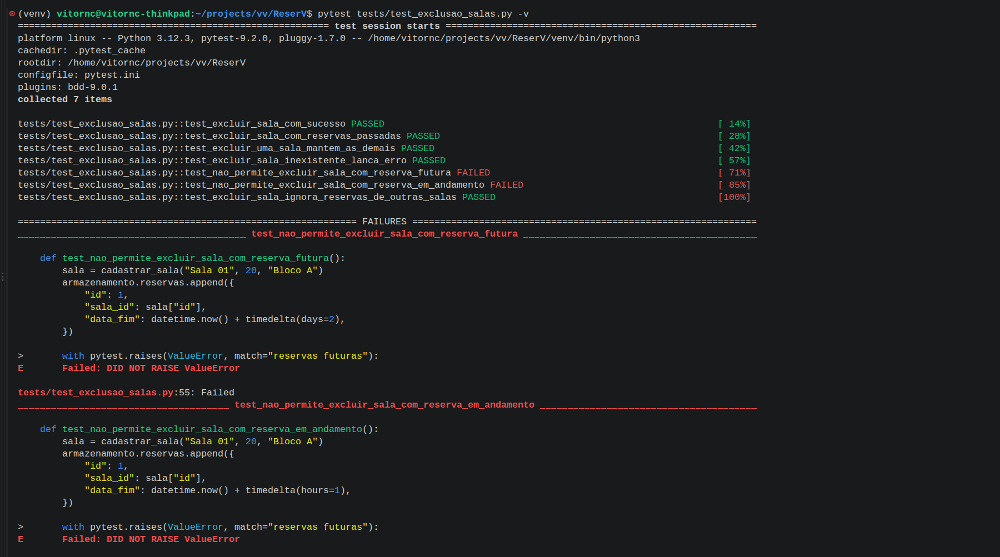  
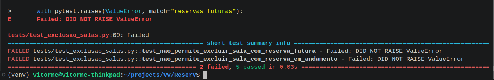  
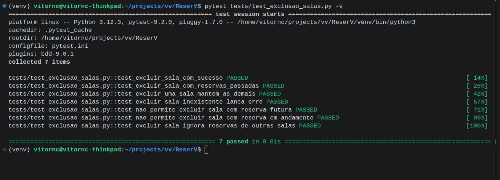  


---

## 6. BDD (Gherkin com pytest-bdd)

Arquivo `tests/features/edicao_exclusao_salas.feature`, em português (`# language: pt`), com **9 cenários**:

| Tipo | Cenário |
|---|---|
| Positivo | Editar informações de uma sala com sucesso |
| Positivo | Editar apenas a capacidade de uma sala |
| Negativo | Não permitir editar sala inexistente |
| Negativo | Não permitir editar sala com nome vazio |
| Negativo | Não permitir editar sala com capacidade inválida |
| Positivo | Excluir sala sem reservas com sucesso |
| Positivo | Excluir sala com reservas passadas com sucesso |
| Negativo | Não permitir excluir sala inexistente |
| Negativo | Não permitir excluir sala com reservas futuras |

- **Red:** Com os cenários descritos e sem os steps definidos, a suíte falhou com `StepDefinitionNotFoundError` para os 9 cenários.
- **Green:** Implementados todos os passos (`@given`, `@when`, `@then`) em `tests/test_bdd_edicao_exclusao.py`, conectando o Gherkin com `editar_sala`, `excluir_sala` e `armazenamento`.
- **Refactor:** Uso de regex com `parsers.re` para permitir testes de strings vazias e passos reutilizáveis.

Evidências:  
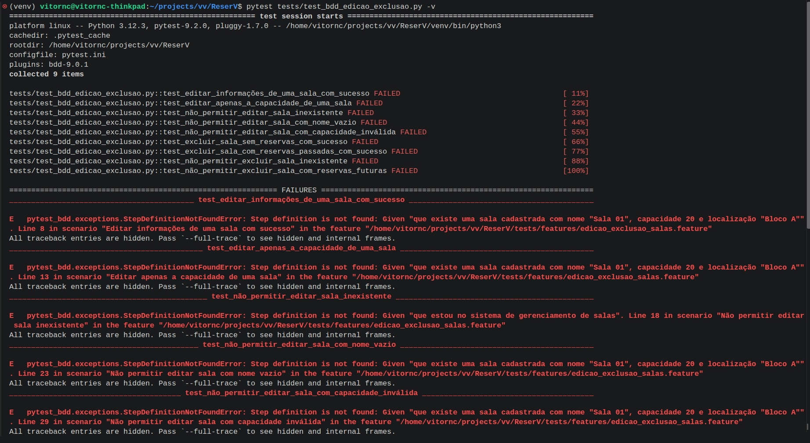  
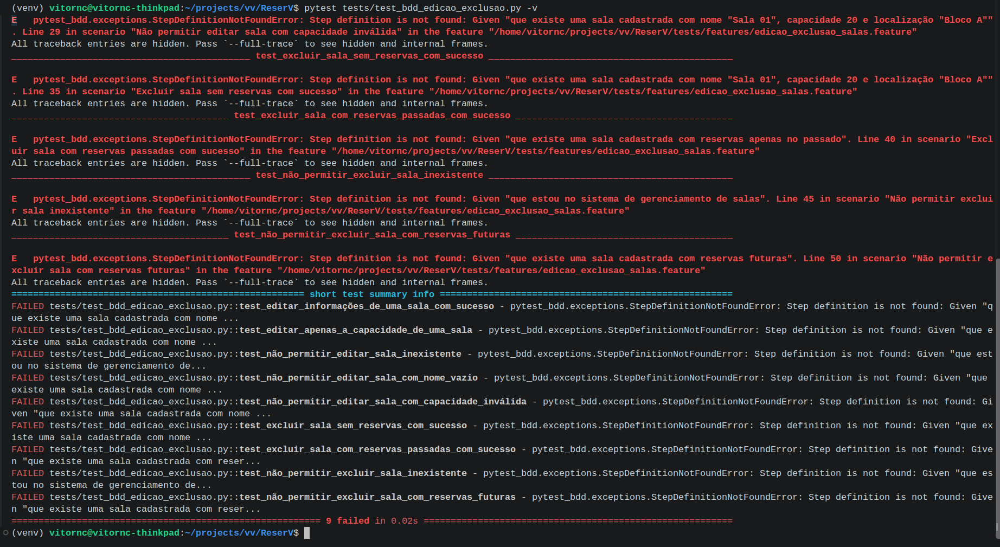  
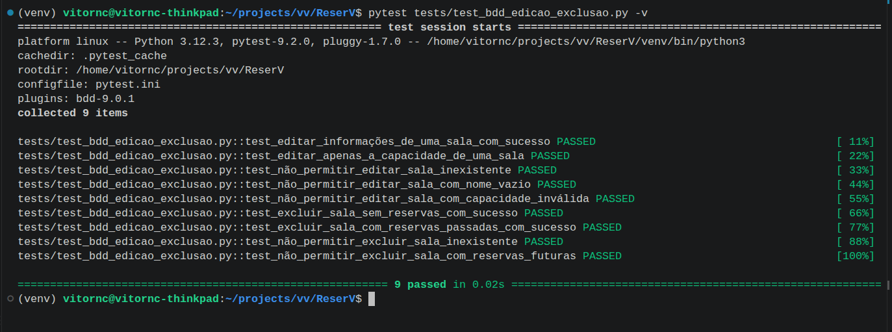

---

## 7. Interface de terminal

Em `src/interface.py`, foram implementadas:
- `opcao_editar_sala()`: solicita o ID, exibe os dados atuais da sala e permite que o usuário digite novos valores ou aperte Enter para manter os atuais.
- `opcao_excluir_sala()`: solicita o ID da sala, confirma a ação do usuário (`s/n`) e efetua a exclusão caso não existam reservas futuras.
- `exibir_menu()`: atualizado com as opções `3 - Editar sala` e `4 - Excluir sala`.

Evidências:  
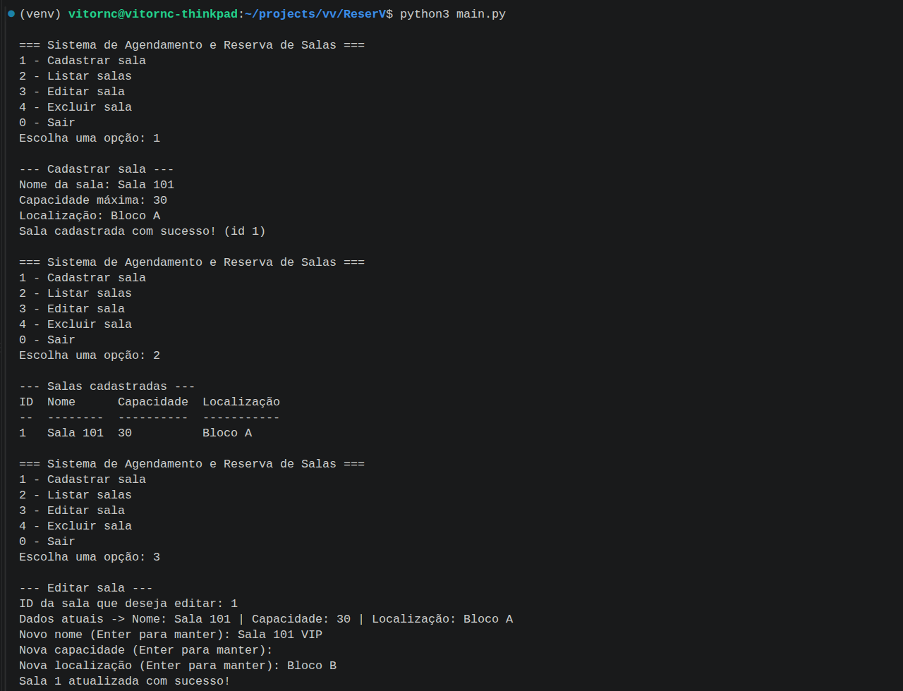  
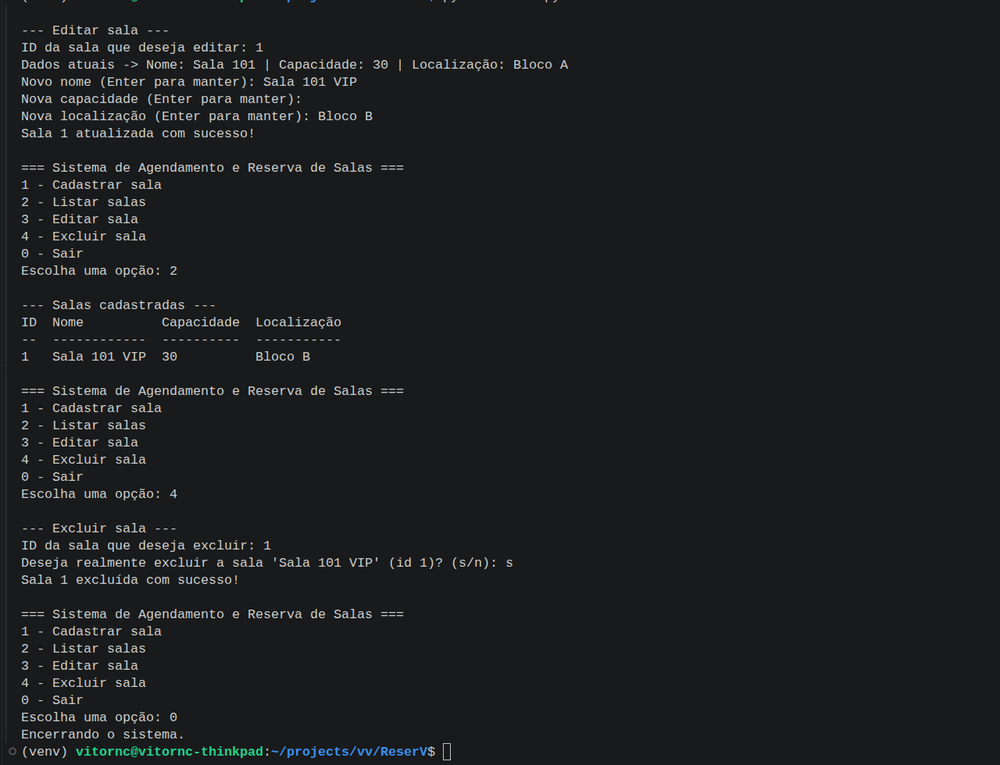

---

## 8. Resultado final

A suíte completa (`pytest -v`) conta com **53 testes passando** (25 do Integrante 1 + 28 do Integrante 2).

Evidências:  
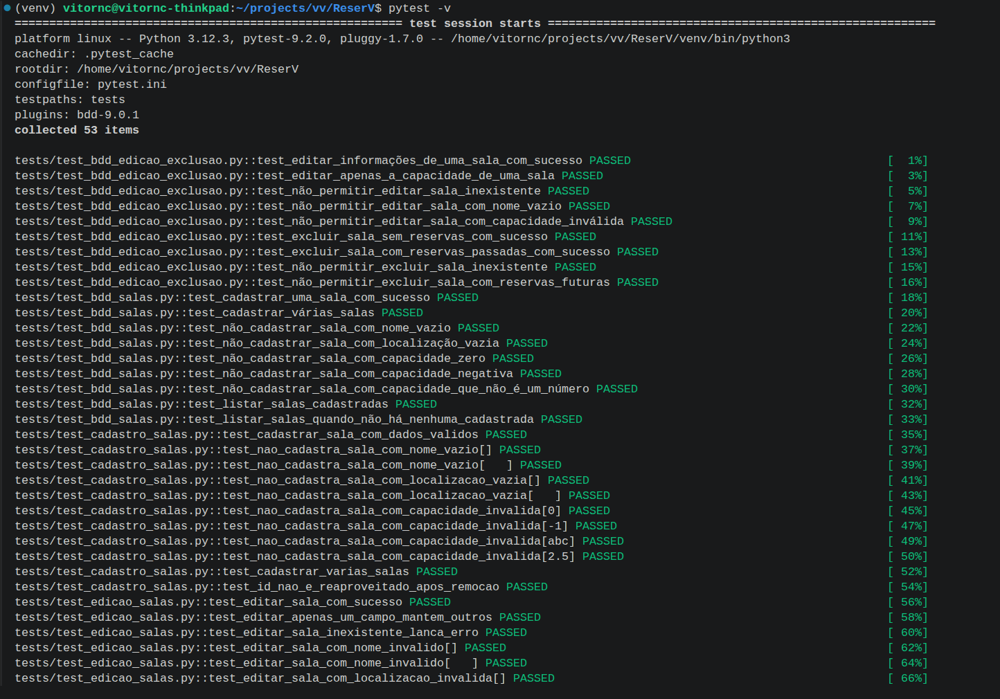  
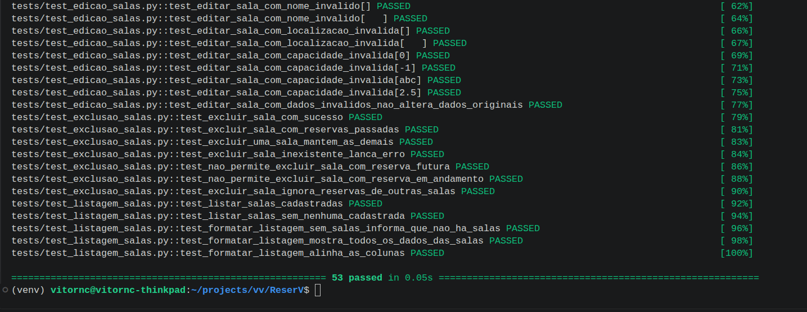

### Rastreabilidade dos requisitos

| Requisito | Teste TDD | Cenário BDD |
|---|---|---|
| Alterar informações de sala cadastrada | `test_editar_sala_com_sucesso`, `test_editar_apenas_um_campo_mantem_outros` | Editar informações de uma sala com sucesso, Editar apenas a capacidade de uma sala |
| Não permitir editar sala inexistente | `test_editar_sala_inexistente_lanca_erro` | Não permitir editar sala inexistente |
| Validações de nome, localização e capacidade na edição | `test_editar_sala_com_nome_invalido`, `test_editar_sala_com_localizacao_invalida`, `test_editar_sala_com_capacidade_invalida` | Não permitir editar sala com nome vazio, Não permitir editar sala com capacidade inválida |
| Integridade dos dados em caso de erro na edição | `test_editar_sala_com_dados_invalidos_nao_altera_dados_originais` | Não permitir editar sala com nome vazio |
| Remover sala sem reservas | `test_excluir_sala_com_sucesso` | Excluir sala sem reservas com sucesso |
| Remover sala com reservas passadas | `test_excluir_sala_com_reservas_passadas` | Excluir sala com reservas passadas com sucesso |
| Não permitir excluir sala com reservas futuras | `test_nao_permite_excluir_sala_com_reserva_futura`, `test_nao_permite_excluir_sala_com_reserva_em_andamento` | Não permitir excluir sala com reservas futuras |
| Não permitir excluir sala inexistente | `test_excluir_sala_inexistente_lanca_erro` | Não permitir excluir sala inexistente |
| Preservação de outras salas e integridade de IDs | `test_excluir_uma_sala_mantem_as_demais`, `test_excluir_sala_ignora_reservas_de_outras_salas` | Excluir sala sem reservas com sucesso |
